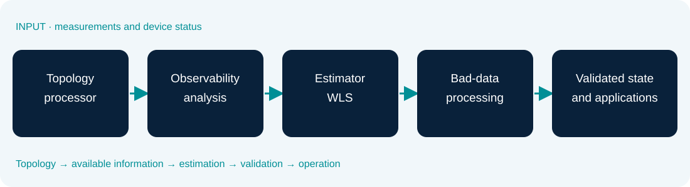

# Introduction to power system state estimation

### Lesson 01 · Real-time operation and the state estimation process

Graduate course · University of São Paulo · Prof. João Bosco A. London Junior

---

## Learning objectives

By the end of this lesson, you should be able to:

- Place **power system state estimation** in the context of real-time operation.
- Distinguish **operating states**, **state variables**, and **measurements**.
- Interpret the model $z=h(x)+e$ and its sources of uncertainty.
- Explain the **four stages of conventional state estimation**.
- Relate observability, redundancy, and bad-data processing.

---

## Lesson outline

1. The evolution of power system operation.
2. Security and operating states.
3. Why the current network state must be determined.
4. Measurement systems and problem formulation.
5. State estimation stages and applications.
6. An illustrative example, limitations, and further developments.

---

## Why do we need to know the network state?

Operators must continually answer:

- Which buses are energized and which devices are connected?
- Are voltages or equipment loadings outside their limits?
- What is the power flow on branches **without direct measurements**?
- Will the system remain secure following an equipment outage?

> Measurements provide **partial and imperfect information**; estimation produces a consistent representation of the current electrical condition.

---

## How power system operation evolved

- **Until the mid-twentieth century:** predominantly local supervision and control.
- **1950s–1960s:** automatic generation control, interconnections, and economic dispatch.
- **1960s:** expansion of remote control and telemetry.
- **From the late 1960s:** greater emphasis on monitoring, security, and computational analysis.
- **From the 1970s:** state estimation became an established control-center function.

Note: The literature assigns a pivotal role to F. C. Schweppe and coauthors' work in 1970. These developments did not occur simultaneously across all utilities and regions.

---

## From supervision to security-oriented operation

**Generation control:** generation–demand balance, frequency, and interchanges.

**Supervisory control (SCADA):** measurement acquisition, switching-device status, and control commands.

**Energy management system (EMS):** interpretation of operating conditions, security assessment, and operational support.

State estimation connects **field data** to the **network model used by analytical applications**.

---

## SCADA: what actually reaches the control center?

**Analog information**

- Voltage and current magnitudes.
- Active and reactive power injections and flows.
- Frequency and other operational quantities.

**Discrete information**

- Switch and circuit-breaker positions.
- Equipment status and alarms.
- Tap positions and other device states, when available.

Note: SCADA stands for Supervisory Control and Data Acquisition. RTUs and IEDs collect and provide data; data quality and synchronization depend on the installed infrastructure.

---

## SCADA is not a state estimator

| SCADA acquisition | State estimation |
|---|---|
| Receives measured values | Reconstructs variables not directly measured |
| Reports status and alarms | Uses the network model to check consistency |
| May contain missing data | Exploits available measurements and redundancy |
| Does not ensure physical consistency | Seeks a state compatible with data and the model |

**Takeaway:** a collection of telemetered values does not, by itself, provide the complete electrical state.

---

## Objectives of real-time operation

- **Monitor** voltages, loadings, and interchanges.
- **Identify** violations in the current operating condition.
- **Assess** relevant contingencies and their consequences.
- **Propose** preventive, corrective, or restorative actions.

All of these require an up-to-date topology model and a reliable estimate of electrical conditions.

---

## Three groups of operating constraints

$$\underbrace{g(x)=0}_{\text{balance and demand supply}}$$

$$\underbrace{h(x)\leq 0}_{\text{operating limits}}$$

$$\underbrace{s(x)\leq 0}_{\text{security criteria}}$$

- $g(x)$: equality constraints associated with system operation.
- $h(x)$: voltage, current, loading, and other operating limits.
- $s(x)$: conditions evaluated for a predefined contingency set.

Note: This classification follows the operating-state discussion in Chapter 2 of Bretas, London Jr., and Carvalho. Exact vector definitions depend on the operational model.

---

## Normal secure state

The desired condition:

$$g(x)=0,\qquad h(x)\leq0,\qquad s(x)\leq0.$$

- Demand is supplied.
- Operating limits are respected.
- Selected contingencies do not cause unacceptable violations.

**Secure does not mean immune to every event:** the assessment depends on the contingency set and adopted assumptions.

---

## Normal alert state

$$g(x)=0,\qquad h(x)\leq0,\qquad\exists\,s_i(x)>0.$$

- The current condition still supplies demand and respects limits.
- However, **at least one assessed contingency** may lead to unacceptable conditions.
- **Preventive control** must be considered.

**Example:** a line operates within its limit, but the loss of another line would overload it.

---

## Emergency and restorative states

**Emergency**

- One or more operating constraints are violated: $\exists\,h_i(x)>0$.
- Corrective or emergency actions may be necessary.

**Restorative**

- Operating limits may have been restored.
- However, some demand or part of the system's electrical integrity has not yet been restored.

Note: In the restorative state, full demand-supply constraints need not be satisfied. Restoring operating limits is different from restoring the entire network.

---

## Transitions between operating states

- **Secure → Alert:** loading changes or reduced contingency security.
- **Alert → Emergency:** a contingency occurs before effective preventive action.
- **Alert → Secure:** preventive or corrective security control.
- **Emergency → Restorative:** disconnections or islanding contain violations.
- **Restorative → Normal:** loads and components are restored.

> Transitions may be **involuntary** events or **deliberate** control actions.

---

## Discussion: secure or alert?

A system operates with:

- All voltages between $0.95$ and $1.05$ p.u.
- All power flows below thermal limits.
- A specified N−1 contingency that would load a line to $115\%$ of its thermal limit.

**Which operating state describes the system? Why?**

Note: The system is in the normal alert state, assuming demand is supplied and current limits are satisfied. The post-contingency condition violates the selected security criterion.

---

## What does “state” mean in a power system?

In sinusoidal steady state, with **known topology and parameters**, the **complex bus voltages** determine the other electrical quantities of interest.

$$\underline V_i=V_i e^{j\theta_i}.$$

- $V_i$: voltage magnitude at bus $i$.
- $\theta_i$: voltage phase angle at bus $i$.

**This set of phasors constitutes the conventional static network state.**

---

## The usual state-vector representation

For a balanced AC system with $n$ buses and one angle reference:

$$x=\begin{bmatrix}\theta_2&\cdots&\theta_n&V_1&\cdots&V_n\end{bmatrix}^{T}.$$

$$\boxed{\dim(x)=2n-1}$$

Choosing $\theta_1=0$ removes the global rotational degree of freedom **when measurements do not supply an absolute reference**.

Note: Synchronized PMUs may change the reference convention. Do not interpret θ1=0 as a physical measurement. In three-phase estimation, problem size depends on the phases present and the chosen parameterization.

---

## Parameters, states, and measurements are different

**Parameters (model):** impedances/admittances, taps, shunts, and connectivity.

**State ($x$):** unknown complex bus voltages at the time of interest.

**Measurements ($z$):** information from measurement devices and, where applicable, virtual measurements or pseudomeasurements.

> The conventional estimator **does not infer everything simultaneously**: topology and parameters are treated as known.

---

## From state to flows and injections

Given $x$ and the admittance matrix $Y_{bus}$:

$$I=Y_{bus}V$$

$$S_i=P_i+jQ_i=V_i I_i^*.$$

The state therefore allows us to calculate:

- Bus current and power injections.
- Branch power flows and losses.
- Voltages and operating-limit indicators.

Note: These are introductory expressions. Complete flow and injection measurement functions are developed in subsequent modeling lessons.

---

## Why not measure every bus voltage?

- Installing and maintaining sensors at every bus may be impractical.
- Conventional SCADA measurements do not always provide **voltage angles**.
- Measurements arrive at different rates and with different delays.
- Temporary communication losses reduce coverage.

Estimation uses **physical relationships between quantities** to infer states that are not directly instrumented.

---

## Measurement types used in estimation

| Measurement type | Quantity | Example |
|---|---|---|
| Bus magnitude | $V_i$ | Bus voltage |
| Injection | $P_i,Q_i$ | Bus power balance |
| Flow | $P_{ij},Q_{ij}$ | Branch power |
| Current | $\lvert I_{ij}\rvert$ | Line current |
| Synchronized phasor | $\underline V_i,\underline I_{ij}$ | PMU |

Each measurement's relationship to the state depends on the **network model**.

---

## Analog, virtual, and pseudomeasurements

**Analog:** values obtained from measurement devices, subject to uncertainty.

**Virtual:** known or strongly justified relationships, such as zero injection at a bus with neither generation nor load.

**Pseudomeasurements:** indirect information, including forecasts and historical consumption or generation.

Pseudomeasurements are generally less reliable and **are not equivalent** to additional physical sensors.

---

## Why can telemetry be imperfect?

- Instrument, transducer, and instrument-transformer errors.
- Acquisition and analog-to-digital conversion noise.
- Packet loss, communication failures, and delays.
- Stale data, unavailable measurements, or inconsistent values.
- Database, topology, or parameter errors: **model errors**, rather than sensor errors.

**Reliability involves both measurement quality and model correctness.**

---

## The mathematical measurement model

$$\boxed{z=h(x)+e}$$

- $z\in\mathbb R^{m}$: vector of $m$ processed measurements.
- $x\in\mathbb R^{n_x}$: unknown state vector.
- $h(x)$: measurement functions defined by the electrical model.
- $e$: measurement errors.

For the complete AC model, $h(x)$ is generally **nonlinear**.

---

## Interpreting an individual measurement

$$z_i=h_i(x)+e_i.$$

Example of a voltage-magnitude measurement:

$$z_{V_i}=V_i+e_{V_i}.$$

Example of a power-injection measurement:

$$z_{P_i}=h_{P_i}(V,\theta,Y_{bus})+e_{P_i}.$$

The objective is not to fit every reading **exactly**, but to find a state globally consistent with the available information.

---

## A statistical model for measurement errors

A conventional assumption is:

$$\mathbb E[e]=0,\qquad R=\mathbb E[ee^T].$$

If the errors are independent:

$$R=\operatorname{diag}(\sigma_1^2,\ldots,\sigma_m^2).$$

- $\sigma_i$: standard deviation assigned to measurement $i$.
- Smaller errors generally justify **greater statistical weight**.

Note: The covariance matrix may be nondiagonal when errors are correlated. Gaussian noise is a conventional assumption, but does not describe gross errors or systematic failures.

---

## The estimation problem

Candidate states $x$ produce calculated measurements $h(x)$.

The difference between a reading and its calculated value is the **residual**:

$$r(x)=z-h(x).$$

An estimator seeks $\hat x$ yielding small residuals **according to a mathematical criterion and the confidence assigned to the measurements**.

---

## From simple differences to weighting

A precise sensor and an uncertain pseudomeasurement **should not influence the result equally**.

In weighted least squares (WLS):

$$\boxed{\hat x=\arg\min_x\,(z-h(x))^T R^{-1}(z-h(x))}$$

WLS is developed in detail in **Lesson 03**.

Note: The expression assumes an invertible R and statistically consistent weighting. Prefer stable factorizations to explicit inversion in numerical implementations.

---

## Power flow versus state estimation

| Power flow | State estimation |
|---|---|
| Starts from specified electrical conditions | Starts from telemetry and a model |
| Solves balance equations | Fits uncertain data |
| Typically uses bus types and specified injections | Can use heterogeneous, redundant measurements |
| Produces a calculated operating point | Reconstructs operating conditions from data |

Both use network equations, but solve **problems with different input information**.

---

## Four stages of conventional state estimation

1. **Topology processing** and measurement association in the bus–branch model.
2. **Observability analysis and restoration**.
3. **State estimation** using available measurements and parameters.
4. **Bad-data processing** for analog measurements.

> These stages form a chain that may require feedback and reprocessing.

Note: This conventional sequence is presented in Lesson 1 (London Jr., 2024) and Section 2.3 of the Bretas, London Jr., and Carvalho course material.

---

## From SCADA to operational applications

The estimated state's quality depends on the consistency of every stage.

---

## Stage 1 — Topology processor

**Inputs:**

- Physical substation and equipment records.
- Switch and circuit-breaker status.
- Meter locations and types.

**Outputs:**

- Updated topology in the **bus–branch model**.
- Association between measurements and network elements.

With an incorrect topology, measurement equations may describe a **different network from the physical one**.

---

## Physical model versus bus–branch model

**Physical model (bus sections and equipment):**

- Represents switching devices and their connections.
- Distinguishes open and closed positions.

**Bus–branch model:**

- Groups electrically connected sections.
- Represents equivalent buses and branches for calculations.

> Topology processing is more than drawing a diagram: it changes connectivity, variables, and measurement functions.

---

## Example: what happens when a breaker opens?

Consider two bus sections connected by a circuit breaker.

- **Closed breaker:** the sections may belong to the same electrical bus.
- **Open breaker:** they may become distinct buses.
- Associated flow and injection measurements must be reassigned.

**Question:** what happens if the processor reports “closed” while the device is open?

Note: Students should identify a possible topology error, measurement inconsistency, and potential degradation of estimation.

---

## Stage 2 — Is the system observable?

Does the measurement set determine **all relevant state variables**?

- If **yes**, the system is observable under the chosen formulation.
- If **no**, **observable islands** and unobservable regions may exist.
- Restoration may require **new measurements**, virtual measurements, or pseudomeasurements.

**Measurement count and independent information are different concepts.**

---

## Observability: a local algebraic view

For a linearization around $x_0$:

$$\Delta z\approx H(x_0)\,\Delta x+e,$$

$$H(x_0)=\left.\frac{\partial h(x)}{\partial x}\right|_{x=x_0}.$$

A **local** observability condition, after handling references and constraints, is:

$$\boxed{\operatorname{rank}(H)=n_x}$$

Note: For nonlinear systems, the Jacobian rank test is local. It does not, by itself, establish global uniqueness.

---

## Are many measurements enough?

Not necessarily.

Consider two unknowns, $x_1$ and $x_2$, and five sensors measuring only $x_1$.

$$H=\begin{bmatrix}1&0\\1&0\\1&0\\1&0\\1&0\end{bmatrix}.$$

Although $m=5>n_x=2$:

$$\operatorname{rank}(H)=1<2.$$

**The state $x_2$ cannot be determined from these measurements.**

---

## Redundancy versus observability

**Observability:** is there enough independent information to estimate the state?

**Redundancy:** is there additional information for consistency checking and tolerance to losses?

- A configuration may be observable with little redundancy.
- Repeated information can improve precision without revealing unobserved states.
- The **local** distribution of measurements matters.

---

## Critical measurements

A **critical measurement** is one whose removal makes the system unobservable under the chosen formulation.

Consequences:

- Its unavailability can prevent estimation of part of the system.
- Its information is structurally indispensable to observability.
- Under conventional assumptions, bad data in that channel cannot be detected using residual tests alone.

Note: The concept and its consequences are developed further in the observability and bad-data lessons.

---

## Restoring observability

Possible approaches include:

1. Recover unavailable readings.
2. Incorporate new physical or phasor measurements.
3. Use justified **virtual measurements**.
4. Add **pseudomeasurements** with appropriate uncertainty.
5. Estimate **observable islands** separately.

> Pseudomeasurements add information to the algorithm, but do not create independent physical information of the same quality as a sensor.

---

## Stage 3 — Estimate complex bus voltages

Estimation uses:

- **Topology** and meter association from Stage 1.
- An **observable set**, with restoration if necessary, from Stage 2.
- **Network parameters** stored in the model.
- **Measurements** and their statistical weights.

The main result is:

$$\boxed{\hat x=\text{estimated electrical state}}$$

Flows, injections, currents, and EMS indicators follow from this estimate.

---

## Why does the estimator need optimization?

For a candidate state, the model generally cannot reproduce **every reading exactly**:

$$z_1\neq h_1(x),\quad z_2\neq h_2(x),\quad\ldots$$

The task is to select a **consistent compromise** between potentially conflicting measurements, accounting for their uncertainties.

In the AC formulation, fitting is **nonlinear** and normally requires iteration.

---

## Stage 4 — Bad-data processing

A gross error is not simply the small random noise expected from an instrument.

Possible causes include:

- Misassigned, shifted, or substantially incorrect readings.
- Telemetry, transducer, or converter failures.
- Saturation, scaling errors, and acquisition problems.

**Objective:** detect inconsistencies and, where possible, identify suspect channels for treatment.

---

## Why does redundancy help detect errors?

Suppose two sensors measure the same quantity:

$$z_1=100\ \text{MW},\qquad z_2=120\ \text{MW}.$$

There is an inconsistency, but **which sensor is wrong?**

If a third independent reading reports:

$$z_3=101\ \text{MW},$$

there is additional evidence with which to investigate the discrepancy.

Note: This is a conceptual example. Opposite-direction flow measurements are not exact duplicates unless losses, conventions, and measurement conditions are accounted for.

---

## Residuals and inconsistency detection

After estimating $\hat x$:

$$r=z-h(\hat x).$$

- Residuals are **post-fit differences**.
- Their magnitude must be interpreted using measurement **uncertainty** and **redundancy**.
- A small residual **does not guarantee** the absence of bad data.

Statistical tests and residual-processing limitations are discussed in Lessons 04 and 05.

---

## Three distinct classes of error

| Class | Incorrect information | Example |
|---|---|---|
| Measurement | A telemetry value | A reported flow far above its actual value |
| Topology | Switch or breaker status | An open breaker recorded as closed |
| Parameter | An electrical model value | Incorrect line reactance |

**Takeaway:** an abnormal residual may originate in a **sensor**, the **topology**, or the **model**.

---

## Numerical example: three-bus DC model

Assume $\theta_1=0$ and three branch-flow measurements, with unit susceptances in the DC approximation:

$$x=\begin{bmatrix}\theta_2\\\theta_3\end{bmatrix},\qquad
z=\begin{bmatrix}P_{12}\\P_{23}\\P_{13}\end{bmatrix}=
\begin{bmatrix}0.10\\0.05\\0.16\end{bmatrix}.$$

Using $P_{ij}\approx\theta_i-\theta_j$:

$$z\approx Hx+e,\quad
H=\begin{bmatrix}-1&0\\1&-1\\0&-1\end{bmatrix}.$$

Note: This is an original illustrative example with synthetic per-unit data. Assumptions: angles in radians, voltage magnitudes approximately 1 p.u., negligible resistance, and normalized susceptances. It is not a complete AC case.

---

## What can we infer before calculating?

The model implies:

$$P_{13}\approx P_{12}+P_{23}.$$

However, the telemetry reports:

$$0.16\neq0.10+0.05.$$

**No state reproduces all three readings exactly.**

This is a natural estimation problem and does not necessarily indicate bad data.

---

## An introductory least-squares solution

With **equal weights** and full-column-rank $H$:

$$\hat x=(H^TH)^{-1}H^Tz.$$

The estimate is:

$$\hat x=\begin{bmatrix}-0.1033\\-0.1567\end{bmatrix}\ \text{rad}.$$

The calculated measurements are:

$$\hat z=H\hat x\approx
\begin{bmatrix}0.1033\\0.0533\\0.1567\end{bmatrix}.$$

Note: This unweighted linear solution is for teaching purposes. Explicit inversion is a theoretical expression; prefer QR or another stable factorization in numerical implementations.

---

## Interpreting the numerical result

$$r=z-\hat z\approx\begin{bmatrix}-0.0033\\-0.0033\\+0.0033\end{bmatrix}.$$

- The estimator accommodated **three slightly inconsistent readings**.
- None was imposed as absolute truth.
- The result depends on **model equations** and **weights**.
- Additional measurements do not guarantee the absence of bad data.

**Question:** what changes if one reading receives a much larger weight?

---

## The complete control-center cycle

**Field devices and SCADA**

$\downarrow$ acquisition, initial checks, and status data

**Topology processor**

$\downarrow$ bus–branch model and measurement locations

**Observability → Estimation → Error analysis**

$\downarrow$ validated state and calculated quantities

**EMS applications: monitoring, contingencies, and control support**

---

## Where is state estimation used?

- Security and contingency assessment.
- Voltage and loading monitoring.
- Consistency checking of incoming measurements.
- Data preparation for operational tools.
- Support for preventive, corrective, and restorative control.

> Confidence in downstream analyses depends on the **quality of the estimated state** and its assumptions.

---

## Conventional and generalized estimation

**Conventional:** a bus–branch representation, with topology processed in advance and parameters usually treated as known.

**Generalized:** expands the representation and joint treatment of information, potentially including device states, switching-element flows, and topology-related problems.

The generalized approach is developed in depth by **Monticelli (1999)**.

Note: Generalization does not automatically estimate every parameter. It requires specific parameterization, information, and algorithms.

---

## What about PMUs?

**Phasor Measurement Units (PMUs)** provide synchronized voltage and current phasor measurements.

Potential benefits:

- Synchronized angle information.
- Improved observability when appropriately located.
- Integration of SCADA and PMU data in hybrid estimators.

**Challenge:** different update rates, synchronization, error models, and reference conventions.

---

## Distribution system state estimation

Distribution networks require additional attention to:

- **Three-phase unbalance** and diverse connections.
- Radial or meshed topology and many nodes.
- Sparser instrumentation and greater use of pseudomeasurements.
- Distributed energy resources, changing loads, and smart metering.

The balanced single-phase representation of the conventional formulation **does not describe all these conditions**.

---

## Static versus dynamic estimation

**Static estimation:** calculates a state from information available at an instant or within a short acquisition window.

$$z_k=h(x_k)+e_k.$$

**Dynamic estimation:** also uses a temporal evolution model:

$$x_{k+1}=f(x_k,u_k)+w_k.$$

The latter requires additional assumptions about dynamics and process noise. Lesson 13 develops this topic.

---

## Limitations of the conventional formulation

- Dependence on recorded topology and parameters.
- Observability limited by meter placement.
- Sensitivity to bad data and correlated errors.
- Steady-state and frequently balanced-system assumptions.
- Computational cost and timely update requirements.

These limitations motivate **robust, hybrid, three-phase, and dynamic estimators**.

---

## What does a state estimator actually do?

A state estimator is more than a numerical filter.

It combines:

1. **Physical network model** — topology and parameters.
2. **Available information** — analog, virtual, and pseudomeasurements.
3. **Identifiability conditions** — observability.
4. **Statistical criterion** — estimation and weighting.
5. **Diagnostics** — inconsistency and error analysis.

Its output is an **estimated representation**, not a perfect measurement of reality.

---

## Review questions

1. Why does SCADA alone not provide the complete system state?
2. What distinguishes the **normal secure** and **normal alert** states?
3. Why can a system with $m>n_x$ remain unobservable?
4. What does the topology processor do?
5. How do measurement, topology, and parameter errors differ?

Note: Encourage answers supported by physical examples rather than definitions alone.

---

## Exercise for the next lesson

Consider a **three-bus** system with $\theta_1=0$ and DC measurements:

$$P_{12},\quad P_{23},\quad P_{13}.$$

1. Write $x$ and the matrix $H$ for susceptances $b_{12},b_{23},b_{13}$.
2. Determine the number of states and the rank of $H$.
3. Remove $P_{13}$: is the system still observable?
4. Also remove $P_{23}$: what happens?

**Next lesson:** power flow, network models, and topology processing.

---

## Core references — I

**[1]** BRETAS, N. G.; LONDON JR., J. B. A.; CARVALHO, B. E. B. *Estimação de Estado em Sistemas Elétricos de Potência* [Power System State Estimation]. EESC/USP course material, supplied 2020 edition; original in Portuguese.

Suggested reading:

- Chapter 1 — Introduction.
- Chapter 2 — Real-time operation and the estimation process.
- Chapter 4 — Measurement model and WLS estimator: an initial reading.

---

## Core references — II

**[2]** MONTICELLI, A. *State Estimation in Electric Power Systems: A Generalized Approach*. Kluwer Academic Publishers, 1999.

**[3]** ABUR, A.; GÓMEZ EXPÓSITO, A. *Power System State Estimation: Theory and Implementation*. Marcel Dekker, 2004.

Suggested reading:

- Monticelli: Chapters 1–3, covering real-time modeling, least squares, and DC estimation.
- Abur & Expósito: Chapter 1, fundamentals, and the beginning of Chapter 2, WLS.

---

## Source of the lesson structure

J. B. A. London Jr., *SEL-5717 — Estimação de Estado em Sistemas Elétricos de Potência*. Lesson 1: course overview. EESC/USP, supplied 2024 material; original in Portuguese.

This lesson was **rewritten and expanded** for teaching, with original examples and explicit mathematical assumptions.

**Next lesson:** from measured quantities to the functions $h_i(x)$.

---

## Textbook foundations · Three different questions

**Observability:** do these measurements distinguish the modeled states?

**Precision:** how strongly do noisy measurements constrain each observable direction?

**Model validity:** do the topology, parameters, and operating assumptions describe the actual network?

A full-rank estimator can be inaccurate because of poor precision or an incorrect model. A small residual alone answers none of these questions completely.

Reading: [3] Chapters 2, 4, 7–8; [1] Chapters 2, 5–6.

---

## What a covariance statement assumes

For a linear measurement model with known covariance:

$$z=Hx+e,\qquad \mathbb E[e]=0,\qquad \mathbb E[ee^T]=R\succ0$$
$$\operatorname{Cov}(\hat x-x)=(H^TR^{-1}H)^{-1}$$

This expression assumes full column rank and a correct model. For AC estimation it is normally a local approximation at the estimated operating point.

Unmodeled bias is not represented by merely reporting a smaller diagonal of this covariance.

Reading: [3] §§2.4–2.6; [1] §4.3.

---

## Real-time modeling is a chain of decisions

Switching-device indications determine electrical connectivity. Connectivity and equipment parameters determine the network model. The model determines the measurement functions.

$$\text{device status}\longrightarrow\text{network model}\longrightarrow h(x)\longrightarrow\hat x$$

An analog residual can therefore indicate a faulty sensor, an incorrect parameter, or an incorrect topology. Diagnosis must compare these hypotheses rather than equating every mismatch with a bad analog reading.

Reading: [2] Chapters 1 and 6; [1] §2.4.

---

## Two meanings of robustness

**Numerical robustness** concerns roundoff, scaling, conditioning, and reliable matrix factorizations.

**Statistical robustness** concerns departures from the assumed error distribution, contamination, and influential observations.

QR can improve a least-squares computation without protecting it from outliers. A robust loss can reduce outlier influence while still requiring a stable numerical solver.

These distinctions guide the numerical methods in Lessons 3–5 and the robust estimators in Lesson 12.

Reading: [3] Chapters 3 and 6; [2] Chapters 9 and 13.

---

## References

**[1]** N. G. Bretas, J. B. A. London Jr., and B. E. B. de Carvalho, *Estimação de Estado em Sistemas Elétricos de Potência*, course manuscript, 2019, supplied version Sep. 18, 2020. Chapters 2, 5–6.

**[2]** A. Monticelli, *State Estimation in Electric Power Systems: A Generalized Approach*. Kluwer Academic Publishers, 1999. Chapters 1 and 6.

**[3]** A. Abur and A. Gómez Expósito, *Power System State Estimation: Theory and Implementation*. Marcel Dekker, 2004. Chapters 2, 4, 7–8.

PDF page numbers count file pages starting at 1.

---

## Sources and further study

- Aula 1 - Estimação - 2024.pdf

Educational adaptation in Markdown and LaTeX, with redrawn figures. The lesson and topic-block sequence is preserved; repeated animation steps are consolidated.
