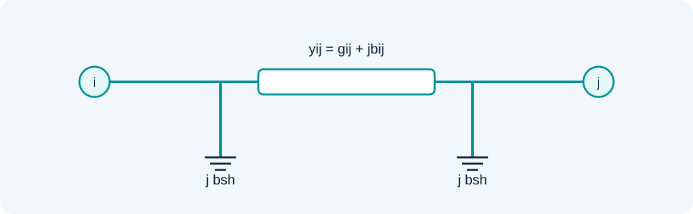
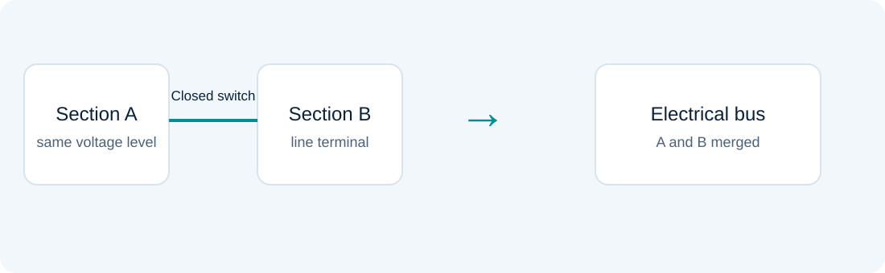

# Power flow and topology processing

### Lesson 02 · Electrical models, sweeps, and topology

Graduate course · University of São Paulo · Prof. João Bosco A. London Junior

---

## Lesson outline

1. Power flow review: model, equations, and solution.
2. Sweep methods for radial feeders.
3. Substation configuration, network configuration, and meter association.

**Objective:** construct the electrical model used by the state estimator.

---

## The power flow problem

Determine a network's steady-state condition for specified topology, demands, and generation.

The unknowns are complex voltages and unspecified powers. Equations express physical network laws; the basic formulation does not statistically fit redundant measurements.

---

## Conventions and bases

$$\underline V_i=V_i e^{j\theta_i},\quad Y=G+jB,\quad S_i=P_i+jQ_i$$

- Electrical quantities are per unit; angles in equations are in radians.
- Positive injection: generation minus demand at a bus.
- Flow $S_{ij}$ is positive from bus $i$ into branch $i$–$j$.

Do not confuse a branch's series susceptance with an entry of the nodal matrix $Y$.

---

## The π line model

$$y_{ij}=\frac{1}{r_{ij}+jx_{ij}}=g_{ij}+jb_{ij}$$

$b_{ij}^{sh}$ represents **half** the line's total capacitive susceptance at each terminal.

---

## Building the admittance matrix

For a branch without a transformer:

$$Y_{ij}=Y_{ji}=-y_{ij}$$

$$Y_{ii}=y_i^{sh}+\sum_{j\in\mathcal N_i}(y_{ij}+jb_{ij}^{sh})$$

Transformer taps and phase shifts change these contributions. Build the matrix using the actual circuit model.

---

## Bus power balances

From $I=YV$ and $S_i=\underline V_i\underline I_i^*$:

$$P_i=V_i\sum_jV_j(G_{ij}\cos\theta_{ij}+B_{ij}\sin\theta_{ij})$$

$$Q_i=V_i\sum_jV_j(G_{ij}\sin\theta_{ij}-B_{ij}\cos\theta_{ij})$$

Here, $\theta_{ij}=\theta_i-\theta_j$. Every term follows the net-injection convention.

---

## Bus types

| Type | Specified | Determined |
|---|---|---|
| PQ | $P_i,Q_i$ | $V_i,\theta_i$ |
| PV | $P_i,V_i$ | $Q_i,\theta_i$ |
| Reference | $V_i,\theta_i$ | $P_i,Q_i$ |

The reference bus fixes the angle origin and balances the power mismatch required to supply losses.

---

## Two calculation subsystems

First determine non-reference bus angles and PQ bus voltage magnitudes:

$$n_x=2n_{PQ}+n_{PV}$$

Then calculate PV bus reactive powers, reference-bus powers, and branch flows. Reactive generation limits may require a bus-type change.

---

## Newton's method in one dimension

To solve $f(x)=0$, linearize at $x^k$:

$$f(x^k)+f'(x^k)\Delta x^k\simeq0$$

$$x^{k+1}=x^k-\frac{f(x^k)}{f'(x^k)}$$

The initial approximation and derivative affect convergence. A very small derivative makes the step problematic.

---

## Newton–Raphson for AC power flow

Define the mismatches $\Delta P=P^{\mathrm{spec}}-P(V,\theta)$ and $\Delta Q=Q^{\mathrm{spec}}-Q(V,\theta)$.

$$\begin{bmatrix}P_\theta&P_V\\Q_\theta&Q_V\end{bmatrix}
\begin{bmatrix}\Delta\theta\\\Delta V\end{bmatrix}
=\begin{bmatrix}\Delta P\\\Delta Q\end{bmatrix}$$

Solve, update the state, and recalculate the mismatches. Specify an explicit stopping tolerance.

---

## Linearized power flow

With $V_i\simeq1$, small angle differences, and negligible losses:

$$P_{ij}\simeq\frac{\theta_i-\theta_j}{x_{ij}},\qquad P=B_{CC}\theta$$

Remove the reference variable to solve the system. This model does not calculate the AC voltage-magnitude profile or reactive power balance.

---

## Why use sweeps on radial networks?

The tree structure allows currents or powers to be accumulated from terminal nodes to the substation, with voltages updated in the opposite direction.

Each iteration has two network passes. Radial topology provides a natural parent–child ordering.

---

## Current-summation sweep

For a constant-power load:

$$I_i^{\mathrm{load},k}=\left(\frac{S_i^{\mathrm{load}}}{V_i^k}\right)^*$$

$$I_{ij}^k=I_j^{\mathrm{load},k}+\sum_{\ell\in \operatorname{children}(j)}I_{j\ell}^k$$

During the forward sweep:

$$V_j^{k+1}=V_i^{k+1}-z_{ij}I_{ij}^k$$

Shunts and ZIP loads require additional contributions consistent with the circuit model.

---

## Power-summation sweep

During the backward sweep, add downstream demands and branch losses:

$$S_{ij}=S_j^{\mathrm{load}}+\sum_{\ell}S_{j\ell}+z_{ij}|I_{ij}|^2$$

During the forward sweep, use flows and currents to update voltages. Because losses depend on voltages, the procedure is iterative.

---

## Sweep convergence criterion

$$\max_i|V_i^{k+1}-V_i^k|<\varepsilon_V$$

Also record power balance, the iteration limit, and voltage limits. A small increment alone does not replace checking physical balances.

---

## Topology processor: inputs and outputs

**Inputs:** physical connectivity, switch/breaker status, equipment records, and physical meter associations.

**Outputs:** electrical buses, in-service branches, energized islands, and measurement associations in the bus–branch model.

The conventional estimator assumes this stage has been performed correctly.

---

## A bus section is not an electrical bus

Sections connected through ideal closed devices at the same voltage level may form one electrical bus. Opening a device does not always remove a line: the outcome depends on alternative paths.

---

## Stage 1 · Substation configuration

1. Identify bus sections and internal devices.
2. Group sections connected by closed devices.
3. Associate line, transformer, load, and generator terminals.
4. Determine the resulting electrical buses.

Graph traversal or a disjoint-set structure can establish internal connectivity.

---

## Stage 2 · Network configuration

Connect the buses identified within substations through in-service lines and transformers.

Identify connected components and their sources. A component disconnected from the main grid may form an electrical island; whether it is energized depends on its sources.

---

## Stage 3 · Equipment and meter tabulation

For each bus and branch, tabulate equipment, parameters, and associated channels.

- Aggregate loads connected to the same bus.
- Preserve the terminal and direction of every flow measurement.
- Topological reduction changes the interpretation of injection measurements.

A correct bus list with incorrectly associated meters still produces an incorrect model.

---

## Updating after a switching action

A status change may affect only one substation, merge buses, or split an existing bus.

Update the affected region, rebuild the required associations, and reassess observability. Reprocessing the entire network is straightforward, but can discard useful information from the previous case.

---

## Conventional and generalized models

In the conventional approach, the topology processor reduces the network before the estimator computes the state.

The generalized model retains substation details and represents devices explicitly, allowing topology inconsistencies to be addressed in an expanded formulation. Lesson 10 returns to this topic.

---

## Assignment 1 · From diagram to model

[Consult the original Assignment 1 statements (Portuguese)](../assets/listas/lista-01.pdf)

For each switching sequence, record the starting condition, section groups, resulting buses, active branches, and meter associations.

For the power flow exercises, report bases, tolerances, losses, and balances. These results become the reference for measurement simulation in later lessons.

---

## Sources and further study

- Aula 2 - Revisão de Fluxo de Carga - 2024.pdf
- Aula 2 - Fluxo de Carga de Varredura Direta_Inversa - Estimação 2024.pdf
- Aula 2 - Configurador de redes - Estimação 2024.pdf

Educational adaptation in Markdown and LaTeX, with redrawn figures. The lesson and topic-block sequence is preserved; repeated animation steps are consolidated.
