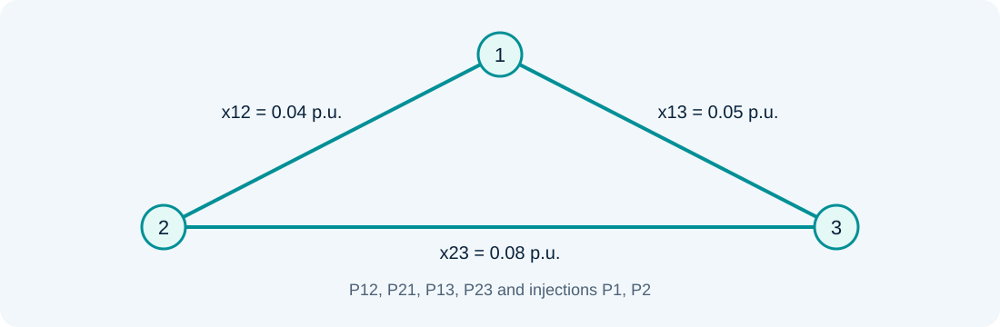

# Statistics and linear WLS estimation

### Lesson 03 · The Pθ model and weighted least squares

Graduate course · University of São Paulo · Prof. João Bosco A. London Junior

---

## Outline: statistics → regression → the Pθ model

Relate meter quality to equation weighting and derive the linear estimator.

The final laboratory reproduces **Assignment 2, Exercise 1**, allowing comparison of weighted and unweighted solutions.

---

## Random variables and probability

A discrete variable takes countable values; a continuous variable has a probability density function.

$$\sum_kP(X=x_k)=1,\qquad \int_{-\infty}^{\infty}f_X(x)\,dx=1$$

For a continuous variable, probability is an integral over an interval, not the density's value at a point.

---

## Mean, variance, and standard deviation

$$\mu_X=E[X],\qquad \sigma_X^2=E[(X-\mu_X)^2]$$

The standard deviation $\sigma_X$ has the variable's units; variance has the square of those units.

**Example:** a power measurement with $\sigma=0.008$ p.u. has variance $0.000064$ p.u.$^2$.

---

## Gaussian distribution

$$f_X(x)=\frac{1}{\sigma\sqrt{2\pi}}
\exp\left[-\frac{(x-\mu)^2}{2\sigma^2}\right]$$

The negative exponent ensures decaying tails. Standardization gives $U=(X-\mu)/\sigma\sim\mathcal N(0,1)$.

---

## Random vectors and covariance

$$\mu=E[z],\qquad R=E[(z-\mu)(z-\mu)^T]$$

$R_{ii}$ is the variance of measurement $i$; $R_{ij}$ is the covariance between channels. For uncorrelated errors, $R$ is diagonal.

Independence implies zero covariance; the converse is not generally true.

---

## Linear measurement model

$$z=Hx+e,\qquad E[e]=0,\qquad E[ee^T]=R$$

$H\in\mathbb R^{m\times n}$ relates $m$ measurements to $n$ state variables. Its rows depend on topology, parameters, and meter types and locations.

In this formulation, the state vector is an unknown deterministic quantity.

---

## Static and dynamic estimation

A static estimator uses measurements from one acquisition window to estimate a network condition.

A dynamic estimator also uses a temporal evolution model. This course develops the static formulation first; WLS does not require a dynamic model.

---

## Unweighted least squares

$$J_{LS}(x)=\sum_i(z_i-h_i^Tx)^2=\|z-Hx\|_2^2$$

Minimizing the sum of squared residuals finds a compromise between inconsistent equations. Equal channel weights assume compatible scaling and precision.

---

## LS normal equations

$$\nabla J_{LS}(x)=-2H^T(z-Hx)=0$$

$$H^TH\hat x=H^Tz$$

The solution is unique when $H$ has full column rank. Redundant measurements do not make the equations exact; they support state estimation and residual assessment.

---

## Why use weights?

For uncorrelated errors, each contribution is normalized by its variance:

$$J_{WLS}(x)=\sum_i\frac{(z_i-h_i^Tx)^2}{\sigma_i^2}$$

A more precise measurement receives greater weight. The correct weight is $1/\sigma_i^2$, not $1/\sigma_i$.

---

## WLS and maximum likelihood

If $e\sim\mathcal N(0,R)$ and $R$ is known:

$$-2\log L(x)=C+(z-Hx)^TR^{-1}(z-Hx)$$

The term $C$ does not depend on $x$. Maximizing likelihood is therefore equivalent to minimizing the WLS objective.

---

## Weighted normal equations

$$G\hat x=H^TR^{-1}z,\qquad G=H^TR^{-1}H$$

$$\hat x=(H^TR^{-1}H)^{-1}H^TR^{-1}z$$

The inverse makes the theoretical solution explicit. Numerically, solve using a factorization, QR, or another method appropriate to the conditioning.

---

## Existence and precision of the estimate

For $R\succ0$ and $\operatorname{rank}(H)=n$:

$$G\succ0,\qquad E[\hat x]=x$$

$$\operatorname{Cov}(\hat x)=G^{-1}$$

These properties assume a correct model and the specified errors. Topology or parameter errors can introduce bias.

---

## The hat matrix and fitted measurements

$$\hat z=H\hat x=Kz$$

$$K=H(H^TR^{-1}H)^{-1}H^TR^{-1}$$

$K^2=K$: projecting an already projected vector leaves it unchanged. In the original coordinates, $K$ need not be symmetric; orthogonality uses the weighted inner product.

---

## Residual sensitivity

$$r=z-\hat z=Sz,\qquad S=I-K$$

$$SH=0,\qquad H^TR^{-1}r=0$$

The residual is orthogonal to the columns of $H$ in the weighted metric. It is therefore not simply a copy of each meter's error.

---

## Residual covariance

$$\Omega=E[rr^T]=SRS^T$$

$$\Omega=R-H(H^TR^{-1}H)^{-1}H^T$$

Even when measurement errors are uncorrelated, residuals are generally correlated. This matrix is essential to bad-data processing.

---

## The Pθ model and angle reference

$$P_{ij}\simeq\frac{\theta_i-\theta_j}{x_{ij}}$$

Set $\theta_1=0$. For a three-bus network, $x=[\theta_2\;\theta_3]^T$.

An injection measurement sums incident branch contributions. Its row in $H$ can involve several angles.

---

## Assignment 2 · Three-bus network

$x_{12}=0.04$, $x_{13}=0.05$, $x_{23}=0.08$ p.u. Bus 1 is the reference.

Measurement order: $P_{12},P_{21},P_{13},P_{23},P_1,P_2$.

---

## Exercise 1: matrix and data

$$H=\begin{bmatrix}-25&0\\25&0\\0&-20\\12.5&-12.5\\-25&-20\\37.5&-12.5\end{bmatrix}$$

$$z=[6.2452,\;-6.234,\;6.992,\;1.13,\;13.265,\;-5.0055]^T$$

Powers are per unit and angles are in radians. Check, for example, $P_1=P_{12}+P_{13}$ in the lossless model.

---

## Weights and reference results

$$\sigma=[0.008,0.008,0.008,0.008,0.010,0.010]^T$$

| Formulation | $\hat\theta_2$ (rad) | $\hat\theta_3$ (rad) |
|---|---|---|
| Unweighted | −0.2504 | −0.3488 |
| Weighted | −0.2504 | −0.3484 |

The assignment's reference values are rounded to four decimal places.

---

## Textbook foundations · Whiten before projecting

Factor $R=LL^T$ and define $A=L^{-1}H$, $b=L^{-1}z$. Then:

$$\min_x(z-Hx)^TR^{-1}(z-Hx)=\min_x\|b-Ax\|_2^2$$

Whitening turns the uncertainty ellipsoid into a sphere. For diagonal $R$, it simply divides each row and reading by its standard deviation.

Solve triangular systems with $L$; explicitly forming $R^{-1}$ is unnecessary.

Reading: [1] §§2.6 and 3.2; [2] §4.4.

---

## Thin QR and the cost of normal equations

For full column rank, write $A=Q_1T$, where $Q_1^TQ_1=I$ and $T$ is nonsingular and upper triangular:

$$T\hat x=Q_1^Tb,\qquad G=A^TA=T^TT$$
$$\kappa_2(G)=\kappa_2(A)^2$$

QR avoids explicitly squaring the condition number during matrix formation. It does not restore information lost through nearly dependent measurement rows.

**Assignment 2:** very unequal standard deviations can make a mathematically observable system numerically difficult.

Reading: [1] §§3.1–3.2, PDF pp. 54–59; [2] §4.4, PDF pp. 81–87.

---

## Why WLS has this covariance

With deterministic $x$ and a correct linear model:

$$\hat x-x=G^{-1}H^TR^{-1}e$$
$$\operatorname{Cov}(\hat x-x)=G^{-1}H^TR^{-1}RR^{-1}HG^{-1}=G^{-1}$$

WLS is the best linear unbiased estimator under the stated second-moment assumptions. Gaussian errors additionally make it a maximum-likelihood estimator; Gaussianity is not needed for the covariance calculation above.

Reading: [1] §§2.4–2.6; [3] Chapter 2 and Appendix A.

---

## Absolute precision and relative weights

If every standard deviation is multiplied by $c>0$, the relative weights stay fixed:

$$R'=c^2R,\qquad \hat x'=\hat x,\qquad J'=J/c^2$$
$$\operatorname{Cov}'(\hat x)=c^2G^{-1}$$

Thus the Assignment 2 estimate can stay identical while its reported uncertainty and statistical test change. Changing just one channel's precision also changes the estimate.

Do not calibrate the assumed noise merely to force a desired goodness-of-fit decision.

Reading: [1] §§2.6 and 5.4; equations rederived for the course laboratory.

---

## References

**[1]** A. Abur and A. Gómez Expósito, *Power System State Estimation: Theory and Implementation*. Marcel Dekker, 2004. §§2.4–2.6, 3.1–3.2.

**[2]** N. G. Bretas, J. B. A. London Jr., and B. E. B. de Carvalho, *Estimação de Estado em Sistemas Elétricos de Potência*, course manuscript, 2019, supplied version Sep. 18, 2020. §§4.3–4.4.

**[3]** A. Monticelli, *State Estimation in Electric Power Systems: A Generalized Approach*. Kluwer Academic Publishers, 1999. Chapter 2 and Appendix A.

PDF page numbers count file pages starting at 1.

---

## Sources and further study

- Aula 3 - Revisão de estatística - 20 08 2024.pdf
- Aula 3 - Estimador de estado WLS linear - 20 08 2024.pdf

Educational adaptation in Markdown and LaTeX, with redrawn figures. The lesson and topic-block sequence is preserved; repeated animation steps are consolidated.

---

## Laboratory guide · One network, two estimators

1. Compare LS and WLS with the original data.
2. Change the precision of $P_{12}$ and observe its influence.
3. Add a bias to $P_{12}$ and compare residuals and objective values.

**Question:** does increasing an incorrect reading's weight improve the estimate?

[Complete original Assignment 2 (Portuguese)](../assets/listas/lista-02.pdf)
