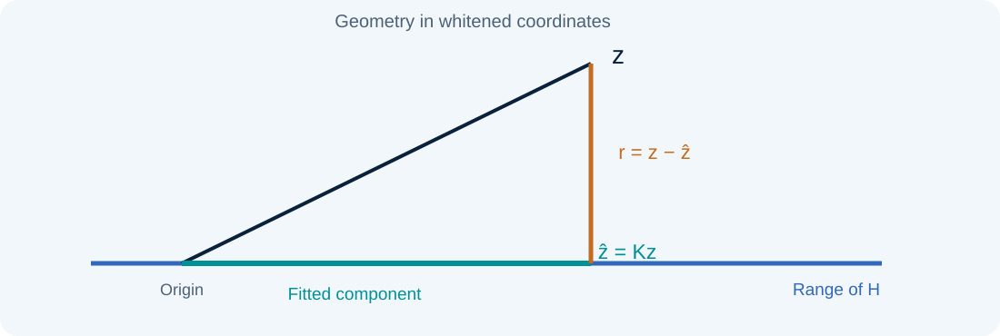
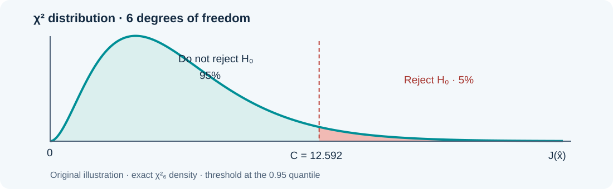
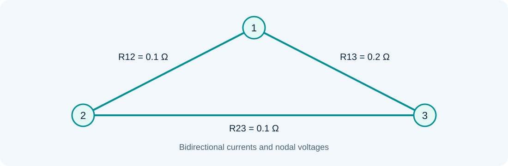

# Bad-data processing in linear state estimation

### Lesson 04 · Chi-square, largest normalized residual, and recovery

Graduate course · University of São Paulo · Prof. João Bosco A. London Junior

---

## Lesson outline

1. Measurement errors, residuals, and residual covariance.
2. Global detection through the chi-square test of $J(\hat x)$.
3. Identification through the largest normalized residual.
4. The $\hat b$ test, removal, and measurement recovery.
5. Assignment 3 and reproducible simulation.

Notation follows the course manuscript [BLC], §§6.4–6.5. The laboratory concludes the lesson.

---

## Notation used throughout this lesson

| Symbol | Meaning |
|---|---|
| $m$, $N$ | Number of measurements and estimated state variables |
| $z_i$, $h_i(\hat x)$ | Reading and value predicted at the estimated state |
| $e_i$, $r_i$ | Measurement error and post-fit residual |
| $R_{ii}=\sigma_i^2$ | Measurement-error variance |
| $\Omega_{ii}$ | Residual variance |

$G$, $K$, and $S$ denote the gain, projection, and residual-sensitivity matrices. $M$ will denote the number of Monte Carlo runs, keeping $N$ reserved for state variables.

---

## Ordinary noise and gross errors

$$z=h(x)+e,\qquad e=e^{(0)}+a$$

Under the nominal model, $e^{(0)}$ has zero mean and covariance $R$. The vector $a$ represents an additional gross perturbation, possibly concentrated in one channel.

A reversed sign, transducer fault, incorrect association, or communication error can violate the noise assumptions. An incorrect topology or parameter can also produce inconsistent residuals.

**The tests first establish inconsistency; they do not automatically establish its cause.**

---

## Detection differs from identification

**Detection:** does the measurement set exhibit evidence against the assumed error model?

**Identification:** which measurement or subset should be investigated?

The $J(\hat x)$ test aggregates the discrepancy across the whole set. The largest normalized residual test compares individual channels after accounting for their residual dispersion.

Neither test supplies missing redundancy. Critical measurements and critical sets impose structural limits.

[BLC] §6.5, PDF p. 160.

---

## From estimation to residuals

For a linear model, or a fixed local linearization:

$$\Delta z=H\Delta x+e,\qquad G=H^TR^{-1}H$$
$$\Delta\hat x=G^{-1}H^TR^{-1}\Delta z,\qquad \Delta\hat z=H\Delta\hat x=K\Delta z$$

$H$ has $m$ rows and $N$ independent columns after fixing the reference. For the strictly linear circuit example, the same relations apply directly to $z$ and $x$.

[BLC] §6.4, Eqs. (6.1)–(6.3), PDF p. 158.

---

## The residual is not the measurement error

$$K=HG^{-1}H^TR^{-1},\qquad S=I-K,\qquad r=Se$$

Since $KH=H$, we have $SH=0$: the residual removes the fitted state component. A bias in one reading propagates through a whole column of $S$.

[BLC] §6.4, Eqs. (6.4)–(6.7).

---

## Residual covariance: the matrix needed for testing

Under the nominal model, $\mathbb E[e]=0$ and $\operatorname{Cov}(e)=R$:

$$\mathbb E[r]=0,\qquad \Omega=\operatorname{Cov}(r)=SRS^T=SR$$
$$\Omega=R-HG^{-1}H^T,\qquad \Omega_{ii}=R_{ii}S_{ii}$$

The diagonal identity assumes diagonal $R$. Independent measurement errors generally produce correlated residuals because the state fit uses the readings jointly.

[BLC] §6.4, Eqs. (6.9)–(6.10), PDF p. 159.

---

## Useful properties of the residual matrices

$$S^2=S,\qquad \Omega^T=\Omega,\qquad \Omega_{ij}^2\leq\Omega_{ii}\Omega_{jj}$$

$S$ is generally not symmetric in ordinary coordinates. In contrast, $\Omega$ is symmetric and positive semidefinite.

For positive residual variances, $\rho_{ij}=\Omega_{ij}/\sqrt{\Omega_{ii}\Omega_{jj}}$ expresses residual correlation. Large $|\rho_{ij}|$ indicates strong interaction; comparing raw covariance magnitudes across different measurement units can be misleading.

[BLC] §6.4; [AE04] §5.1.

---

## Chi-square: a sum of squared standardized variables

If $u_1,\ldots,u_\nu$ are independent standard normal variables:

$$Y=\sum_{j=1}^{\nu}u_j^2\sim\chi_\nu^2$$
$$\mathbb E[Y]=\nu,\qquad \operatorname{Var}(Y)=2\nu$$

$Y$ is nonnegative and generally asymmetric. Its number of degrees of freedom, $\nu$, determines both the distribution and the detection threshold.

[BLC] §6.5.1, PDF p. 160.

---

## The WLS index: first write the summation

Assume independent errors $e_i\sim\mathcal N(0,\sigma_i^2)$, with known positive variances. Following the manuscript:

$$J(\hat{x})=\sum_{i=1}^{m}\frac{[z_i-h_i(\hat{x})]^2}{\sigma_i^2}$$
$$=\sum_{i=1}^{m}\frac{r_i^2}{R_{ii}}=r^TR^{-1}r$$

Each summand measures a squared discrepancy relative to the corresponding measurement-error variance. The sum is dimensionless, allowing different measurement types to contribute on a common scale.

[BLC] §6.5.1, Eqs. (6.11) and (6.17), PDF pp. 160–162.

---

## Distribution of the minimized index

For a correct observable linear model with the preceding Gaussian assumptions:

$$J(\hat x)\sim\chi^2_{m-N}$$
$$\mathbb E[J(\hat x)]=m-N,\qquad \operatorname{Var}[J(\hat x)]=2(m-N)$$

$m$ is the number of available readings; $N$ is the number of estimated state variables. The distribution concerns the cost **after WLS fitting**, not the index at an arbitrary state.

For nonlinear AC estimation, this calibration is based on a local linear approximation.

[BLC] Eqs. (6.11)–(6.12); [AE04] §5.4.

---

## Textbook foundations · Degrees of freedom

Whiten the linear model using $A=R^{-1/2}H$ and $\Pi=A(A^TA)^{-1}A^T$:

$$R^{-1/2}r=(I-\Pi)R^{-1/2}e,\qquad \operatorname{rank}(I-\Pi)=m-N$$

Only $m-N$ independent Gaussian directions remain after fitting. The residual components themselves need not be independent.

If $m=N$ and $H$ is nonsingular, every reading is fitted exactly: $r=0$ and $J=0$. There is then no residual redundancy for this detection test.

[BLC] §6.5.1; [AE04] §§5.1 and 5.4. Projection derivation in this site's notation.

---

## Null hypothesis and the upper-tail decision

$H_0$: the measurements and network model satisfy the assumed unbiased Gaussian error model. A detectable gross perturbation tends to increase the index.

$$C=\chi^2_{m-N,\,1-\alpha}$$
$$J(\hat x)>C\ \Rightarrow\ \text{reject }H_0$$
$$J(\hat x)\leq C\ \Rightarrow\ \text{do not reject }H_0$$

Not rejecting means insufficient evidence against the model, rather than proof that every channel is free of gross errors.

[BLC] §6.5.1, Eqs. (6.13)–(6.14).

---

## Significance means an upper-tail probability

$$\Pr\{J(\hat x)>C\mid H_0\}=\alpha,\qquad \int_0^C f_{m-N}(t)\,dt=1-\alpha$$

For $m-N=6$ and $\alpha=0.05$, $C\simeq12.592$. Increasing $\alpha$ lowers the threshold, trading more false alarms for greater sensitivity.

[BLC] Eqs. (6.14)–(6.16). Original figure for the Assignment 3 degrees of freedom.

---

## Global detection: an executable procedure

1. Check observability and solve WLS to convergence.
2. Compute $r_i=z_i-h_i(\hat x)$ and the summation for $J(\hat x)$.
3. Count the current $m$ and $N$; choose $\alpha$ before examining the result.
4. Obtain $C=\chi^2_{m-N,1-\alpha}$ and compare $J(\hat x)$ with $C$.
5. If rejected, investigate sensors, model errors, and identification statistics.

After removal, recompute the fit and threshold. The old degrees of freedom no longer describe the retained set.

[BLC] §6.5.1, detection procedure, PDF pp. 162–163.

---

## What a large or small J can mean

A large value can reflect gross errors, biased models, underestimated measurement uncertainty, or a failed numerical fit. The global statistic does not locate the cause.

A small value can reflect healthy data, overestimated uncertainty, little redundancy, or a perturbation absorbed by the state estimate.

Multiplying every stated standard deviation by $c$ leaves the fitted state unchanged but divides $J$ by $c^2$. Absolute noise calibration therefore matters for the test.

[BLC] §§6.3–6.5; [AE04] §§5.3–5.4.

---

## Normalized residual: the manuscript's definition

For each channel with $\Omega_{ii}>0$:

$$r_i^N=\frac{|r_i|}{\sqrt{\Omega_{ii}}}=\frac{|r_i|}{\sqrt{R_{ii}S_{ii}}}$$

Following [BLC], **the normalized residual is nonnegative**. The residual $r_i$ itself retains the sign needed for measurement recovery.

Dividing by $\sigma_i$ alone ignores how much the estimator absorbs from that channel. The residual standard deviation is $\sqrt{\Omega_{ii}}$.

[BLC] §6.5.2, Eq. (6.18), PDF p. 163.

---

## Signed and absolute normalized residuals

Introduce the signed auxiliary quantity $u_i=r_i/\sqrt{\Omega_{ii}}$. Under the correct linear Gaussian model:

$$u_i\sim\mathcal N(0,1),\qquad r_i^N=|u_i|$$
$$\Pr\{r_i^N>\beta\}=2[1-\Phi(\beta)]$$

$\Phi$ is the standard normal cumulative distribution. Since $r_i^N\geq0$, its distribution is folded normal, rather than a signed standard normal. This distinction resolves an ambiguity when reading the probability statement alongside the manuscript's absolute-value definition.

[BLC] §6.5.2; the convention of Eq. (6.18) is retained explicitly.

---

## Largest normalized residual: selection and threshold

$$r_{\max}^N=\max_{i:\Omega_{ii}>0}r_i^N,\qquad k\in\operatorname*{arg\,max}_{i:\Omega_{ii}>0}r_i^N$$
$$r_k^N>\beta\ \Rightarrow\ \text{measurement }k\text{ is suspect}$$

The manuscript uses $\beta=3$ as a common choice. Investigate ties and criticality before removing the selected reading.

$C$ is a chi-square threshold for a **global sum**; $\beta$ applies to a **normalized channel discrepancy**. The two thresholds describe different statistics.

[BLC] §6.5.2, algorithm, PDF p. 164.

---

## Why the largest normalized residual works locally

Suppose only channel $k$ has deterministic error $a_k$, and every other measurement is perfect. With diagonal $R$:

$$r_j=S_{jk}a_k=\frac{\Omega_{jk}}{R_{kk}}a_k$$
$$r_j^N=\frac{|\Omega_{jk}|\,|a_k|}{R_{kk}\sqrt{\Omega_{jj}}}\leq\frac{\sqrt{\Omega_{kk}}\,|a_k|}{R_{kk}}=r_k^N$$

The inequality follows from $\Omega_{jk}^2\leq\Omega_{jj}\Omega_{kk}$ and requires positive residual variances. Critical-pair ties prevent unique identification; noise in the other channels makes observed rankings probabilistic.

[BLC] Eq. (6.19); [AE04] §5.5, PDF p. 127.

---

## Removal and re-estimation cycle

1. Solve WLS and compute $J$, $r$, and $\Omega$ for the current set.
2. Evaluate global consistency and find $r_{\max}^N$.
3. If the selected channel exceeds $\beta$, check that deletion preserves observability.
4. Remove the suspect reading if the diagnostic assumptions justify it.
5. Refit; recompute residual variances, degrees of freedom, and both decisions.

Stop when no further evidence appears, or when redundancy and model limitations prevent a defensible next removal. An incorrect diagnosis can discard a healthy reading.

[BLC] §6.5.2, with the observability safeguard stated explicitly.

---

## The b-hat test: physical and standardized error

Under the single-error approximation, $r_i\simeq S_{ii}e_i$. Define:

$$\hat e_i=\frac{r_i}{S_{ii}}=\frac{R_{ii}r_i}{\Omega_{ii}},\qquad \hat b_i=\frac{\hat e_i}{\sigma_i}=\frac{\sigma_i r_i}{\Omega_{ii}}$$

$\hat e_i$ has the reading's units, such as amperes. The manuscript's $\hat b_i$ is dimensionless: the estimated error expressed in measurement standard deviations.

Keep $r_i$ signed so the correction has the appropriate direction.

[BLC] §6.5.3, Eqs. (6.22)–(6.24), Observation 6.1, PDF p. 166.

---

## Connecting b-hat to the normalized residual

With the absolute-value definition of $r_i^N$:

$$|\hat b_i|=\frac{\sigma_i}{\sqrt{\Omega_{ii}}}r_i^N=\frac{r_i^N}{\sqrt{S_{ii}}}$$

The manuscript investigates the largest-residual channel using $|\hat b_i|>c$, with the cited choice $c=4$.

$c$ and $\beta$ apply to different statistics. A small $S_{ii}$ amplifies the error estimate and makes recovery sensitive to noise; at $S_{ii}=0$, recovery is unavailable.

[BLC] §6.5.3, Eqs. (6.24)–(6.26), PDF p. 166.

---

## Recovering a measurement with the correct sign

$$z_i^{\mathrm{corr}}=z_i-\hat e_i=z_i-\sigma_i\hat b_i$$

A positive estimated error is subtracted; a negative estimated error increases the corrected reading. Subtracting $|\hat e_i|$ would be wrong for a negatively biased channel.

Recovery assumes a valid model and a credible single-error diagnosis. In an AC estimator, changes in the Jacobian and iterative refitting must also be considered.

[BLC] §6.5.3; [AE04] §§5.7–5.8. Signed correction made explicit.

---

## Removal and recovery: what the identity proves

For diagonal $R$ and a noncritical channel in a fixed linear model:

$$z_i-\frac{r_i}{S_{ii}}=H_i\hat x_{(-i)}$$
$$J_{(-i)}(\hat x_{(-i)})=J(\hat x)-(r_i^N)^2$$

The reconstructed datum matches the prediction from fitting the other readings. This explains why removal and recovery can produce the same estimated state.

It does not make the reconstructed value an independent new sensor reading. The formulas fail at $S_{ii}=0$, where deletion destroys observability.

[AE04] §§5.7–5.8; [M99] §§8.3.3–8.3.5. Linear identities rederived here.

---

## Critical measurements and critical pairs

Deleting a critical measurement destroys observability. In ideal observable linear WLS:

$$S_{ii}=0,\qquad \Omega_{ii}=0,\qquad r_i=0$$

Its normalized residual is undefined, not reassuringly zero. For a critical pair with positive residual variances, $|\rho_{ij}|=1$ can produce equal normalized residuals, preventing a unique diagnosis.

Adding independent local information addresses these limitations; changing a threshold does not.

[BLC] §§6.3–6.5.2; [AE04] §§5.3–5.5.

---

## Multiple gross errors: three configurations

**Non-interacting:** the relevant cross-sensitivities are small, and sequential identification may succeed.

**Interacting, non-conforming:** the errors interact but do not mutually conceal their discrepancies; suspect residuals can remain large.

**Interacting, conforming:** errors partly mask one another, producing small residuals at contaminated channels or large residuals elsewhere.

The manuscript's classification describes how errors combine through $r=Se$, rather than merely how many channels are corrupted.

[BLC] §6.5.2, PDF p. 165.

---

## A local threshold is not a global false-alarm rate

For one nominal channel, $\beta=3$ gives $\Pr\{|u_i|>3\}\simeq0.0027$. The chance that **any** of several channels exceeds 3 is a different probability.

Residuals are correlated. Selection of the maximum and repeated adaptive removal also change the procedure's overall false-alarm behavior.

Report $\alpha$ for the $J$ test and $\beta$ for the residual test separately. A threshold of 3 does not specify a 0.27% false-alarm rate for the entire set.

[AE04] §§5.1–5.7; [BLC] §6.5.2.

---

## Assignment 3 · Direct-current circuit

States: $x=[V_1,V_2,V_3]^T$, in volts. Currents are in amperes.

Branches 1–2, 1–3, and 2–3 have conductances of 10, 5, and 10 siemens, respectively.

---

## Nine measurement equations

$$H=\begin{bmatrix}
10&-10&0\\-10&10&0\\5&0&-5\\-5&0&5\\
0&10&-10\\0&-10&10\\1&0&0\\0&1&0\\0&0&1
\end{bmatrix}$$

Order: $I_{12},I_{21},I_{13},I_{31},I_{23},I_{32},V_1,V_2,V_3$.

---

## Assignment 3: readings and weights

$$z=[52,49,-15,16,-82,80,11,6,14]^T$$

$$W=R^{-1}=\operatorname{diag}(1,1,1,1,1,1,100,100,100)$$

**Check the sign:** this assignment uses $I_{21}=+49$ A. Assignment 2 uses $I_{21}=-49$ A for the corresponding circuit. The laboratory preserves Assignment 3's data.

---

## Circuit example: the global test rejects

The original nine-reading WLS solution is:

$$\hat x=[9.071429,\;7.357143,\;14.571429]^T\ \mathrm V$$
$$J(\hat x)=\sum_{i=1}^{9}\frac{[z_i-H_i\hat x]^2}{\sigma_i^2}\simeq6626.071$$

Here $m=9$, $N=3$, and $\alpha=0.05$. Since $C=\chi^2_{6,0.95}\simeq12.592$, reject $H_0$ and proceed to identification.

The global comparison does not yet establish which reading is wrong.

---

## Circuit example: identify I21

The original fit predicts $\hat I_{21}=-17.142857$ A:

$$r_{I_{21}}=49-(-17.142857)=66.142857\ \mathrm A$$
$$\Omega_{I_{21},I_{21}}\simeq0.660714\ \mathrm A^2,\qquad r_{I_{21}}^N\simeq81.372$$

This is the largest normalized residual and greatly exceeds $\beta=3$. Check that the remaining eight-reading set is observable before removing this channel.

---

## Circuit example: recompute both decisions

After removing $I_{21}$, the recalculated estimate is:

$$\hat x_{(-I_{21})}=[11.037838,\;5.927027,\;14.035135]^T\ \mathrm V$$
$$J_{(-I_{21})}\simeq4.635,\qquad r_{\max}^N\simeq1.342$$

Now $m=8$, $N=3$, and $C=\chi^2_{5,0.95}\simeq11.070$. The global test does not reject, and the largest normalized residual is below 3.

These decisions concern the retained set under the assumed model; they do not establish the sensor's physical failure mechanism.

---

## Circuit example: recover I21

Using the original fit and $\sigma_{I_{21}}=1$ A:

$$\hat e_{I_{21}}\simeq100.108108\ \mathrm A,\qquad \hat b_{I_{21}}\simeq100.108108$$
$$I_{21}^{\mathrm{corr}}=49-100.108108\simeq-51.108108\ \mathrm A$$

The two error estimates happen to have the same numerical value because the standard deviation is 1 A; they have different units and meanings.

The recovered value agrees with $10(\hat V_2-\hat V_1)$ from the solution that excludes $I_{21}$.

---

## Why a recovered datum is not a fresh observation

The recovered $I_{21}$ is calculated from the original data. Treating all nine values as newly independent readings with the original variances would misrepresent their uncertainty.

The laboratory shows the refitted residuals and objective after recovery as an algebraic illustration. Formal post-removal tests use the eight retained independent channels, with five degrees of freedom.

Do not assign a new chi-square calibration merely because a reconstructed measurement was put back into the input vector.

---

## Numerical cross-check of the circuit

| Bus | Printed answer (V) | Recalculated using stated H and z (V) |
|---|---|---|
| 1 | 11.0370 | 11.0378 |
| 2 | 5.9272 | 5.9270 |
| 3 | 14.0358 | 14.0351 |

This small difference is kept explicit. The laboratory solves the stated equations and verifies WLS stationarity rather than forcing the printed answers.

---

## A systematic simulation workflow

Keep reference states, ideal measurements, simulated noise, and estimation results distinct.

---

## Generating synthetic measurements

1. Solve a consistent power flow.
2. Calculate $z^{ref}=h(x^{ref})$ for the selected channels.
3. Specify covariance $R$.
4. Generate $z^{(k)}=z^{ref}+L\xi^{(k)}$ with $LL^T=R$.

For diagonal $R$, use $e_i^{(k)}=\sigma_i\xi_i^{(k)}$ with independent $\xi_i\sim\mathcal N(0,1)$.

---

## Noise, gross errors, and reproducibility

For Monte Carlo run $q$, separate nominal noise from a specified perturbation:

$$z^{(q)}=h(x^{\mathrm{ref}})+L\xi^{(q)}+a^{(q)},\qquad \xi^{(q)}\sim\mathcal N(0,I)$$

Record the seed, run count, distribution, perturbation sizes, and contaminated channels. A deterministic slider offset alone is not a Gaussian noise realization.

Use the same operating points and noise realizations when comparing methods.

---

## Performance metrics

For $M$ simulation runs and state-component index $j$:

$$\operatorname{bias}_j=\frac1M\sum_{q=1}^M(\hat x_j^{(q)}-x_j^{\mathrm{ref}})$$
$$\operatorname{RMSE}_j=\sqrt{\frac1M\sum_{q=1}^M(\hat x_j^{(q)}-x_j^{\mathrm{ref}})^2}$$

Also count false alarms, detection under contamination, correct channel identification, and convergence or observability failures. A good state estimate does not necessarily imply correct error localization.

---

## Assess the test, not just the estimate

Separate clean, single-error, multiple-error, and measurement-loss scenarios. Report unobservable cases and convergence failures.

An identification rate calculated only over converged cases can overstate overall performance.

---

## Textbook reading for this lesson

**[AE04]** Abur & Gómez Expósito, *Power System State Estimation: Theory and Implementation* (2004). §§5.1–5.8.

**[M99]** Monticelli, *State Estimation in Electric Power Systems: A Generalized Approach* (1999). §§8.2–8.3.

**[BLC]** Bretas, London Jr. & Carvalho, *Estimação de Estado em Sistemas Elétricos de Potência* (course manuscript; cover 2019, supplied file version 2020). §§6.4–6.5.3, PDF pp. 158–166. Primary notation for this lesson.

Section numbers identify the original work; any PDF page numbers are 1-based file pages. Added explanations and derivations use this site’s notation. Explicitly labeled extensions are teaching examples.

---

## Sources and further study

- Aula 4 - Processamento de EG - EE linear definições e Teste do Maior RN - 27 08 2024.pdf
- Aula 4 - Processamento de EG - EE linear b_chapeu e JX - 27 08 2024.pdf
- Aula 4 - Sistemática para Teste e Simulação - 27 08 2024.pdf

Educational adaptation in Markdown and LaTeX, with redrawn figures. The lesson and topic-block sequence is preserved; repeated animation steps are consolidated.

---

## Laboratory guide · Detection, identification, recovery

1. **Original data:** compare $J$ with $\chi^2_{6,0.95}$ and $r_{\max}^N$ with $\beta=3$.
2. **Remove suspect:** check the new state, $J$, and the updated five-degree-of-freedom threshold.
3. **Recover suspect:** verify $I_{21}^{\mathrm{corr}}\simeq-51.108108$ A and distinguish $\hat e_{I_{21}}$ from $\hat b_{I_{21}}$.
4. **Increase weight:** explain why a raw residual can decrease while its normalized value increases.

[All original Assignment 3 exercises (Portuguese)](../assets/listas/lista-03.pdf)
