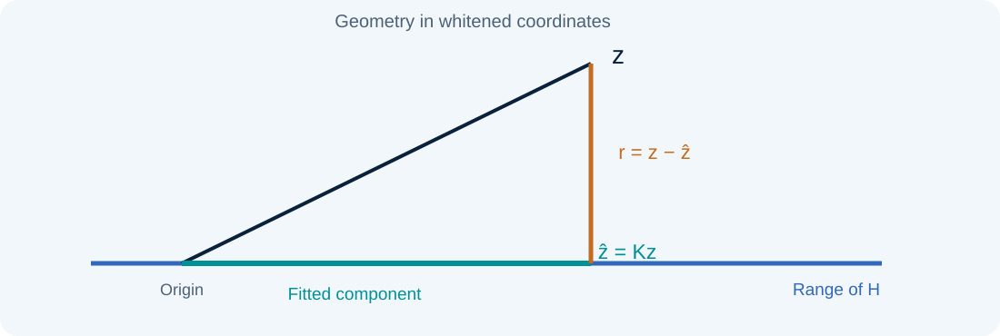
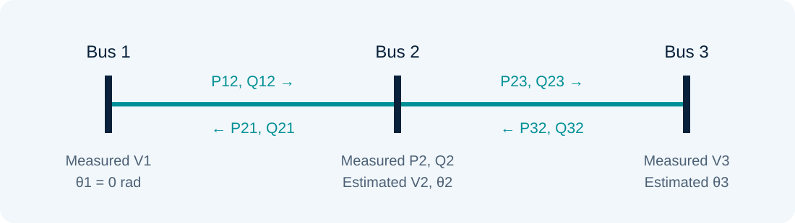

# Nonlinear WLS, decoupling, and the UI index

### Lesson 05 · AC modeling and error interpretation

Graduate course · University of São Paulo · Prof. João Bosco A. London Junior

---

## Lesson outline

1. Coupled AC WLS: model and iterative solution.
2. Pθ–QV decoupling and the fast b/x variant.
3. Bad data in nonlinear estimation.
4. Geometric interpretation and the UI index.

The final laboratory solves the coupled AC exercise from **Assignment 6**.

---

## The AC state vector

$$x=[\theta_2,\ldots,\theta_{n_b},V_1,\ldots,V_{n_b}]^T$$

With $\theta_1=0$ fixed, there are $2n_b-1$ unknowns. Measurements include voltage magnitudes and active/reactive power flows and injections.

Topology and parameters enter the functions $h_i(x)$, not the measurement vector.

---

## The π model and branch current

$$I_{ij}=(y_{ij}+jb_{ij}^{sh})\underline V_i-y_{ij}\underline V_j$$

$$S_{ij}=\underline V_i I_{ij}^*$$

The laboratory uses the per-terminal half-line charging susceptance specified in the assignment table.

---

## Power flow measurement functions

For $y_{ij}=g_{ij}+jb_{ij}$ and without a tap:

$$P_{ij}=g_{ij}V_i^2-V_iV_j(g_{ij}\cos\theta_{ij}+b_{ij}\sin\theta_{ij})$$

$$Q_{ij}=-(b_{ij}+b_{ij}^{sh})V_i^2-V_iV_j(g_{ij}\sin\theta_{ij}-b_{ij}\cos\theta_{ij})$$

Opposite-direction flows are not exact negatives: losses and shunt effects must be included.

---

## Injections and voltage magnitude

$$P_i=\sum_{j\in\mathcal N_i}P_{ij}+P_i^{sh}$$

$$Q_i=\sum_{j\in\mathcal N_i}Q_{ij}+Q_i^{sh}$$

A magnitude measurement has $h_{V_i}(x)=V_i$. Do not count a shunt twice when summing branch flows and local elements.

---

## Optimization problem

$$\min_x J(x),\qquad J(x)=[z-h(x)]^TR^{-1}[z-h(x)]$$

$$\nabla J(x)=-2H(x)^TR^{-1}[z-h(x)]$$

Because $h$ is nonlinear, the stationarity equations require iterative solution. A unique global closed-form solution is generally unavailable.

---

## Gauss–Newton linearization

$$h(x^k+\Delta x)\simeq h(x^k)+H_k\Delta x$$

$$G_k\Delta x^k=H_k^TR^{-1}[z-h(x^k)]$$

$$G_k=H_k^TR^{-1}H_k,\qquad x^{k+1}=x^k+\Delta x^k$$

The approximation neglects Hessian terms involving residual-weighted second derivatives.

---

## Jacobian: an example row

For active power flow $P_{ij}$:

$$\frac{\partial P_{ij}}{\partial\theta_i}=V_iV_j(g_{ij}\sin\theta_{ij}-b_{ij}\cos\theta_{ij})$$

$$\frac{\partial P_{ij}}{\partial\theta_j}=-\frac{\partial P_{ij}}{\partial\theta_i}$$

Columns associated with other buses are zero. Remove the angle-reference column from the estimation system.

---

## Coupled algorithm

1. Initialize $V_i=1$ p.u. and $\theta_i=0$, or use a previous solution.
2. Calculate $h(x^k)$ and $H_k$.
3. Assemble and solve the increment equations.
4. Update the state; reduce the step if necessary.
5. Check convergence and the iteration limit.

After convergence, recalculate fitted measurements and residuals at the final state.

---

## Implementation checks

- Compare analytical derivatives with central differences.
- Check every channel's orientation and units.
- Verify power balances and branch losses.
- Test the final gradient and sensitivity to initialization.

Converging to a numerical vector is insufficient when the measurement function is incorrect.

---

## Pθ–QV decoupling

$$H=\begin{bmatrix}H_{P\theta}&H_{PV}\\H_{Q\theta}&H_{QV}\end{bmatrix}$$

Under certain transmission-system conditions, cross-coupling blocks are smaller. Neglecting them allows alternating active and reactive half-iterations.

Voltage measurements enter the reactive block according to the chosen formulation.

---

## Two half-iterations

$$G_P\Delta\theta=H_{P\theta}^TW_P[z_P-h_P(\theta^k,V^k)]$$

$$G_Q\Delta V=H_{QV}^TW_Q[z_Q-h_Q(\theta^{k+1},V^k)]$$

Update the active block before recalculating residuals for the reactive block. Both half-iterations belong to the same convergence process.

---

## Fast decoupled estimation: b/x variant

In the course formulation:

- Evaluate Jacobians at the *flat start* and keep them constant.
- Neglect blocks $H_{PV}$ and $H_{Q\theta}$.
- Neglect resistance when calculating $H_{QV}$.

Do not confuse this approximation with the laboratory's coupled WLS. Networks with high $R/X$ may violate decoupling assumptions.

---

## Assignment 4 · Decoupled estimation

[Consult original Assignment 4 (Portuguese)](../assets/listas/lista-04.pdf)

Exercise 1 provides this reference for the b/x variant:

$$\theta_2=-0.0470\ \mathrm{rad},\quad V_1=0.9914,\quad V_2=0.9586\ \mathrm{p.u.}$$

The remaining exercises revisit residual identification and RMSE over previously generated samples.

---

## Residuals in the AC model

After convergence:

$$r=z-h(\hat x),\qquad \Omega\simeq R-H(\hat x)G(\hat x)^{-1}H(\hat x)^T$$

Residual covariance is obtained by local linearization. After removing or recovering a reading, re-estimate the state and update the analysis.

---

## Types of multiple errors

- **Noninteracting:** weak correlation between the relevant residuals.
- **Interacting, nonconforming:** interaction does not completely hide inconsistencies.
- **Interacting, conforming:** errors may fit one another and mask residual diagnostics.

The classification concerns residual sensitivity, not merely the physical distance between sensors.

---

## Remove, downweight, or recover

Identification-and-removal methods repeat estimation and diagnosis. Losing redundancy can create new critical measurements.

Other strategies reduce suspect channels' influence or correct their values. All require error assumptions and assessment of the remaining information.

---

## Leverage points

A measurement can strongly influence the fit because of its Jacobian row and statistical weight.

If contaminated, it may shift the estimate while retaining a small residual. Lesson 12 develops this topic alongside WLAV, WLMS, and robust estimators.

---

## WLS geometry

In the linear case, $\hat z=Kz$ lies in the range of $H$. The residual is the component of $z$ orthogonal to that space in the $R^{-1}$ metric.

Use $\|v\|_{R^{-1}}=\sqrt{v^TR^{-1}v}$ to interpret lengths.

---

## Detectable and undetectable error components

For an error $e$:

$$e_U=Ke,\qquad e_D=(I-K)e,\qquad e=e_U+e_D$$

$e_U$ is absorbed by the fitted measurements; $e_D$ appears in residuals. Orthogonality uses the weighted inner product.

---

## Undetectability index UI

For an isolated error in measurement $i$, with diagonal $R$:

$$UI_i=\frac{\|e_{U,i}\|_{R^{-1}}}{\|e_{D,i}\|_{R^{-1}}}
=\sqrt{\frac{K_{ii}}{1-K_{ii}}}$$

The index depends on the model and weights. Large values indicate that the fit absorbs a large share of the error.

---

## Interpreting UI and its limits

$$K_{ii}\to1\ \Rightarrow\ UI_i\to\infty$$

A critical measurement is the limiting case of residual undetectability. For $K_{ii}<1$, high leverage can still leave only a small residual.

**Question:** does reducing a residual necessarily reduce state-estimation error?

---

## Resilient estimation: correntropy

The course material introduces maximum correntropy as an alternative for handling inconsistencies within estimation itself.

A Gaussian function of residuals can limit the influence of large values. Kernel bandwidth controls this influence and affects convergence and estimator behavior.

Robustness is not a substitute for observability.

---

## Assignment 6 · The AC laboratory network

States: $x=[\theta_2,\theta_3,V_1,V_2,V_3]^T$. The reference is $\theta_1=0$.

Measurements: four active flows, four reactive flows, and $P_2,Q_2,V_1,V_3$.

---

## π-model parameters

| Branch | $g$ (p.u.) | $b$ (p.u.) | $b^{sh}$ per terminal |
|---|---|---|---|
| 1–2 | 4.99913 | −15.26308 | 0.0264 |
| 2–3 | 1.135019 | −4.781863 | 0.0219 |

The laboratory uses these exact parameters, retaining resistance, and a diagonal $R$ formed from the stated standard deviations.

---

## Data and reference solution

$$z=[0.819,-0.807,0.990,-0.942,-0.011,-0.012,
0.349,-0.190,0.183,0.338,1.060,0.945]^T$$

| Bus | $V$ (p.u.) | $\theta$ (rad) |
|---|---|---|
| 1 | 1.0591 | 0.0000 |
| 2 | 1.0441 | −0.0435 |
| 3 | 0.9443 | −0.2255 |

The assignment identifies no bad measurement in this set.

---

## Textbook foundations · What Gauss–Newton neglects

For $J=\tfrac12r^TWr$, $r=z-h(x)$, $W=R^{-1}$, the exact Hessian is:

$$\nabla^2J=H^TWH-\sum_i(Wr)_i\nabla^2h_i$$

Gauss–Newton retains $H^TWH$. Small residuals and a useful initial state favor this approximation. Large residuals, poor scaling, or strong curvature can require damping and closer convergence checks.

A small state increment alone does not establish that the model fits the data.

Reading: [1] §2.6; [2] §2.6.

---

## Exact zero injections as equality constraints

For exact constraints $c(x)=0$, set $C=\partial c/\partial x$. A constrained Gauss–Newton step satisfies:

$$\begin{bmatrix}H^TWH&C^T\\C&0\end{bmatrix}\begin{bmatrix}\Delta x\\\lambda\end{bmatrix}=\begin{bmatrix}H^TWr\\-c(x)\end{bmatrix}$$

This enforces the linearized constraint without an arbitrarily tiny measurement variance. The saddle-point matrix is indefinite and needs a suitable factorization.

A bus with an uncertain unmetered load is not an exact zero-injection bus.

Reading: [2] §3.5, PDF pp. 62–63; [3] §4.4.

---

## The UI index in whitened geometry

For diagonal $R$, take a bias $a$ in channel $i$. With orthogonal projector $\Pi$ and $\ell_i=\Pi_{ii}$:

$$\|e_U\|_{R^{-1}}^2=\frac{a^2}{R_{ii}}\ell_i,\qquad \|e_D\|_{R^{-1}}^2=\frac{a^2}{R_{ii}}(1-\ell_i)$$
$$UI_i=\frac{\|e_U\|_{R^{-1}}}{\|e_D\|_{R^{-1}}}=\sqrt{\frac{\ell_i}{1-\ell_i}}$$

Here $e_U$ is absorbed by the state fit and $e_D$ remains in the residual. The two components are orthogonal in the weighted metric, not generally in ordinary coordinates.

Reading: [3] §§7.2–7.3, PDF pp. 173–179. This site explicitly uses the undetectable/detectable ratio.

Note: The manuscript's displayed ratios in §7.2 use reciprocal expressions in different places. To avoid relying on an ambiguous index label, this lesson defines both components and derives their norms. Its UI convention follows the course slides: absorbed component divided by residual component. Static geometric innovation must also be distinguished from the time-domain innovation in Lesson 13.

---

## Scaling, conditioning, and the AC laboratory

Angles, voltage magnitudes, and measurement types have different scales. For a nonsingular diagonal state scaling $x=D\xi$:

$$H_\xi=H_xD,\qquad \Delta x=D\Delta\xi$$

Scaling can improve the numerical representation without creating observability. Compare convergence, weighted residuals, and the physical power balances after mapping the solution back.

**Assignment 6:** changing a measurement's standard deviation changes the statistical problem; rescaling a state coordinate consistently does not.

Reading: [2] §§3.1–3.2; [1] Chapter 13.

---

## References

**[1]** A. Monticelli, *State Estimation in Electric Power Systems: A Generalized Approach*. Kluwer Academic Publishers, 1999. §2.6 and Chapter 13.

**[2]** A. Abur and A. Gómez Expósito, *Power System State Estimation: Theory and Implementation*. Marcel Dekker, 2004. §§2.6, 3.1–3.2, 3.5.

**[3]** N. G. Bretas, J. B. A. London Jr., and B. E. B. de Carvalho, *Estimação de Estado em Sistemas Elétricos de Potência*, course manuscript, 2019, supplied version Sep. 18, 2020. §§4.4, 7.2–7.3.

PDF page numbers count file pages starting at 1.

---

## Sources and further study

- Aula 5 - Estimador WLS Não Linear - 10 09 2024.pdf
- Aula 5 - Estimador WLS Não Linear Desacoplado - 10 09 2024.pdf
- Aula 5 - Erros Grosseiros - definições - EE não linear - 10 09 2024.pdf
- Aula 5 - Índice UI - 10 09 2024.pdf

Educational adaptation in Markdown and LaTeX, with redrawn figures. The lesson and topic-block sequence is preserved; repeated animation steps are consolidated.

---

## AC laboratory guide

1. Reproduce the assignment's rounded values.
2. Add an error of $10\sigma$ to $P_{12}$.
3. Observe which residuals respond and how the state moves.
4. Restore the data and check that the reference result returns.

[Original Assignment 6 and standard-deviation table (Portuguese)](../assets/listas/lista-06.pdf)
