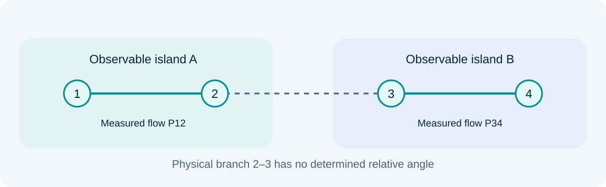

# Observability analysis and restoration

### Lesson 06 · Concepts, islands, and pseudomeasurements

Graduate course · University of São Paulo · Prof. João Bosco A. London Junior

---

## The observability problem

Can the available measurement types and locations determine every state variable?

Distinguish three questions: whether information exists, how the numerical solution behaves, and how topology explains the result.

---

## Information comes before measured values

Structural analysis depends primarily on topology, parameters, and meter configuration. Changing $z$ does not create an independent equation.

In a nonlinear model, the Jacobian also depends on the operating point. Distinguish generic properties from local ones.

---

## Algebraic observability

With the reference fixed:

$$\operatorname{rank}(H)=n_x$$

For $R\succ0$, this is equivalent to nonsingularity of $G=H^TR^{-1}H$.

In the AC case, the Jacobian rank condition characterizes regular local identifiability around the specified point.

---

## Why does rank matter?

If there exists $v\ne0$ such that $Hv=0$, then:

$$H(x+\alpha v)=Hx\qquad\text{for any }\alpha$$

The measurements cannot distinguish these states in the linear model. The null space of $H$ identifies directions lacking information.

---

## An angle reference is not a redundant measurement

Without a reference, rotating all angles equally does not change Pθ flows:

$$H\mathbf1=0$$

An observable network in this model has rank $n_b-1$. Fixing one angle removes the global degree of freedom, not other unobservable directions.

---

## Counting measurements is insufficient

$$m\ge n_x$$

This is necessary but not sufficient. Opposite-direction flows on the same DC branch produce dependent rows.

A region can have many measurements while leaving another region's angles uninformed.

---

## Assignment 2: two independent rows

$$H_{\{P_{12},P_{13}\}}=\begin{bmatrix}-25&0\\0&-20\end{bmatrix}$$

The rank is 2: both angles are determined.

$$H_{\{P_{12},P_{21}\}}=\begin{bmatrix}-25&0\\25&0\end{bmatrix}$$

The rank is 1: $\theta_3$ remains uninformed despite having two measurements.

---

## Numerical observability in the course

The material also defines numerical observability through the ability to obtain a state by iteratively solving the normal equations from a *flat start*.

Rank, conditioning, and convergence are related but distinct: a full-rank Jacobian does not ensure global convergence of a nonlinear algorithm.

---

## Conditioning and scaling

A matrix may have full rank yet be severely ill-conditioned. Incompatible scales and extreme weights can undermine numerical solution.

$$\kappa(H^TR^{-1}H)=\kappa(R^{-1/2}H)^2$$

This equality uses the 2-norm and full column rank. Forming normal equations can amplify numerical difficulties.

---

## A topological view

Represent buses as vertices and branches as edges. A flow measurement relates its terminal buses; an injection measurement relates a bus and its neighbors.

Physical connectivity is not the same as information connectivity.

---

## Observable spanning tree

The topological Pθ model seeks a spanning tree whose edges can be assigned distinct measurements.

A flow reading can cover its own branch. An injection reading can be assigned to an incident edge, respecting one-to-one assignment.

A single injection measurement cannot be reused as several independent equations.

---

## Voltage magnitudes and the QV model

Magnitude readings directly inform the voltage at their bus. In the QV topological construction, they can be represented by fictitious branches connected to a magnitude reference.

Decoupling supports separate active and reactive structural analyses under the adopted assumptions. It does not remove the need to check the full AC model.

---

## Generic observability and special values

A structural test checks generic independence. Exact parameter relationships may introduce dependencies not predicted solely by the nonzero pattern.

State the assumptions supporting equivalence between a topological construction and the algebraic test used.

---

## Observable islands

These are regions where relationships between variables can be estimated from available information. Relative angle references between different islands may remain undetermined.

Electrical islands are defined by physical connections; observable islands are defined by information. Their boundaries need not coincide.

---

## Unobservable branches

A branch between regions without a determined relative angle may have an undetermined flow even when each region is internally observable.

In the DC model, $P_{ij}=(\theta_i-\theta_j)/x_{ij}$: a free inter-island angle difference implies a free inter-island flow.

---

## Discardable measurements in island analysis

An injection may combine flows from regions that are not separately determined. Some such equations must be discarded when estimating islands independently.

Discarding is an island-analysis operation; it does not mean that the physical sensor has ceased to exist.

---

## Restoration using pseudomeasurements

Choose an additional equation whose row increases the set's rank:

$$\operatorname{rank}\begin{bmatrix}H\\h_p^T\end{bmatrix}>\operatorname{rank}(H)$$

Pseudomeasurement type and location matter. Giving a dependent equation a very large weight does not restore observability.

---

## Precision after restoration

A pseudomeasurement can make the solution unique while leaving substantial uncertainty.

Keep the conclusions **observable**, **well-conditioned**, **precise**, and **resilient to losses** distinct. Each requires its own criterion.

---

## Example: restoring information about θ3

Start with $\{P_{12},P_{21}\}$ in the Assignment 2 network. The rank is 1.

Adding $P_{13}$ restores rank 2. A third reading of $P_{12}$ does not inform $\theta_3$.

Reproduce both cases in the final laboratory before enabling the complete set.

---

## Critical measurements and redundancy

In the minimal set $\{P_{12},P_{13}\}$, both measurements are critical. In the complete set, other equations may preserve information after a removal.

Observability asks whether the state is determinable. Criticality asks whether it remains determinable after losing a measurement.

---

## Assignment 5 · Measurement planning

[Open original Assignment 5 (Portuguese)](../assets/listas/lista-05.pdf)

Exercise 1 requests an observable plan with **8 measurements for 9 buses**, then a plan with **11 measurements and no critical measurements**.

Show the association between every measurement and its equation. The specified measurement count is not, by itself, proof of observability.

---

## Preparing for the next lesson's methods

For Assignment 5's unobservable cases, record the islands and the prescribed pseudomeasurement order.

Next, compare how Monticelli & Wu and Bretas identify unobservable branches and guide restoration.

---

## Textbook foundations · Observability is a null-space test

For a linear or locally linearized model:

$$H\Delta x=0$$

Any nonzero solution is a state perturbation invisible to all available measurements. Local observability requires this null space to contain only the permitted reference freedom, removed before testing rank.

With positive-definite $R$, whitening does not change this null space. Greater confidence in the same readings cannot repair a structurally missing direction.

Reading: [1] Chapter 4; [2] §§2.4 and 7.1; [3] §5.1.

---

## Reference freedom and observable islands

In a lossless angle model, each branch flow depends on an angle difference:

$$P_{ij}=b_{ij}(\theta_i-\theta_j)$$

Adding the same angle to all buses in a connected observable island changes none of these readings. Separate islands can have independent reference freedoms.

A physically connected grid need not be observable: connectivity describes available electrical paths; observability also depends on where and what we measure.

Reading: [1] §§4.6–4.7; [3] §5.1.

---

## Why injections complicate a graph argument

For a flow row $h=b(e_i-e_j)^T$, the contribution $w h^Th$ resembles an edge Laplacian.

An injection row combines several incident flows. Its outer product couples multiple neighboring angles, producing a different algebraic structure.

Therefore, counting metered branches alone can miss information supplied by injections. Topological methods need rules that assign injection information consistently to the network.

Reading: [1] §§4.2–4.7; [2] §7.1.

---

## Structural rank and numerical rank

Topological analysis asks whether the measurement pattern generically supports independent state information. Numerical analysis evaluates a particular Jacobian and parameter set.

$$\sigma_{\min}(R^{-1/2}H)\approx0$$

A small singular value signals a weakly constrained direction, even if exact rank is full. Scaling and tolerance affect its numerical diagnosis. Parameter cancellations can also defeat a generic pattern-based conclusion.

Report the model, reference convention, and numerical threshold with an observability result.

Reading: [1] §§4.6–4.7; [2] §§7.1.5 and 7.1.11.

---

## References

**[1]** A. Abur and A. Gómez Expósito, *Power System State Estimation: Theory and Implementation*. Marcel Dekker, 2004. Chapter 4.

**[2]** A. Monticelli, *State Estimation in Electric Power Systems: A Generalized Approach*. Kluwer Academic Publishers, 1999. §§2.4, 7.1.

**[3]** N. G. Bretas, J. B. A. London Jr., and B. E. B. de Carvalho, *Estimação de Estado em Sistemas Elétricos de Potência*, course manuscript, 2019, supplied version Sep. 18, 2020. §5.1.

PDF page numbers count file pages starting at 1.

---

## Sources and further study

- Aula 6 - Observabilidade - Análise e Restauração da Observabilidade, definições e conceitos - Parte 1 - 17 09 2024 - Corrigida.pdf

Educational adaptation in Markdown and LaTeX, with redrawn figures. The lesson and topic-block sequence is preserved; repeated animation steps are consolidated.
