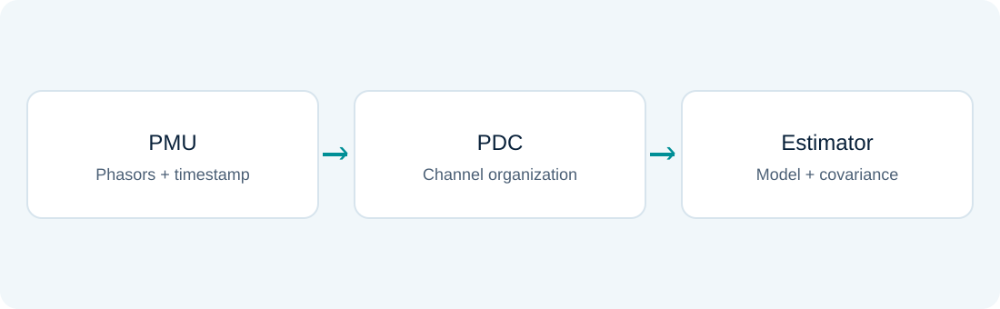

# PMUs and measurement-set updates

### Lesson 09 · Synchronized measurements and triangular factors

Graduate course · University of São Paulo · Prof. João Bosco A. London Junior

---

## Lesson outline

1. Synchronized phasors and SCADA–PMU integration.
2. Updating qualitative measurement properties after losses.
3. Review of solution using triangular factors.

The final laboratory adds phasor channels to Assignment 2's Pθ example to study precision and synchronization errors.

---

## Synchronized measurement systems

A PMU acquires voltages and currents, estimates phasors, and transmits time-referenced data. A PDC receives and organizes channels for applications.

Phase convention, polarity, timestamp, and physical association must accompany the readings.

---

## Phasors and time conventions

For a cosine convention and RMS magnitude:

$$v(t)=\sqrt2 V\cos(\omega t+\theta)\quad\leftrightarrow\quad\underline V=Ve^{j\theta}$$

Angles can only be compared using compatible references. Synchronization and measurement models must represent the same convention.

---

## Rectangular coordinates

$$V_r=V\cos\theta,\qquad V_i=V\sin\theta$$

$$V=\sqrt{V_r^2+V_i^2},\qquad\theta=\operatorname{atan2}(V_i,V_r)$$

Using $\operatorname{atan2}$ preserves the quadrant. Distinguish displayed degrees from the radians required by trigonometric functions.

---

## Phasor current equations

Without a tap, using the π model:

$$\underline I_{ij}=(y_{ij}+jb_{ij}^{sh})\underline V_i-y_{ij}\underline V_j$$

Real and imaginary current components are linear combinations of rectangular voltage components when parameters are known.

Magnitude-only measurements do not share this linearity.

---

## Linear estimation with PMUs

Stacking rectangular voltage and current components:

$$z_{PMU}=H_{PMU}x_{\mathrm{rect}}+e_{PMU}$$

An all-phasor estimator may be linear, but still requires adequate coverage, correct parameters, and an appropriate covariance. A multichannel PMU is not just one equation.

---

## Covariance transformation

To convert a polar reading to rectangular coordinates:

$$T=\begin{bmatrix}\cos\theta&-V\sin\theta\\\sin\theta&V\cos\theta\end{bmatrix}$$

$$R_{\mathrm{rect}}\simeq T R_{\mathrm{polar}}T^T$$

Even a diagonal polar covariance can produce correlated rectangular components. This is a local first-order propagation.

---

## Hybrid estimation

$$z=\begin{bmatrix}z_{SCADA}\\z_{PMU}\end{bmatrix},\qquad
h(x)=\begin{bmatrix}h_{SCADA}(x)\\h_{PMU}(x)\end{bmatrix}$$

Measurements must represent compatible times. Different rates, delays, and correlations affect the statistical model and fusion strategy.

---

## Clock errors and angle errors

Under the adopted convention, a time displacement $\Delta t$ corresponds to:

$$\Delta\theta=2\pi f\Delta t$$

For $f=60$ Hz and $\Delta t=100\ \mu s$, $\Delta\theta\simeq0.03770$ rad, or $2.16^\circ$.

Assigning large weights to every PMU does not eliminate a common bias.

---

## A teaching extension of Assignment 2

Add angle measurements $\theta_2$ and $\theta_3$ to the six-channel Pθ model:

$$H_{\mathrm{hybrid}}=\begin{bmatrix}H_{\mathrm{SCADA}}\\I_2\end{bmatrix}$$

In the laboratory, unbiased additional readings are centered on the original set's WLS solution. This isolates the effect of a known additional time error.

Note: PMU channels are synthetic, with nominal covariance independent of SCADA channels in the declared model. Centering values on an existing solution is an experimental choice, not evidence of field accuracy. If an actual SCADA estimate is reused as a pseudomeasurement, its correlation with the original readings must be considered to avoid double-counting information.

---

## Base-case qualitative properties

Record observability, critical measurements, CMSs, and relevant loss sets for the plan using all available channels.

Retain the transformed structure $H_\Delta$ and basic/supplementary associations. Analyze contingencies relative to this structure.

---

## Losing supplementary measurements only

Observability is preserved if every basic measurement of an independent basis remains.

However, criticality and critical sets may change: previously protected channels may become critical. Update the diagnosis even if rank does not decrease.

---

## Losing a basic measurement

Find a supplementary measurement that can replace its information and update the basis.

If the loss contains no minimal rank-destroying set, a basis exchange may recover the representation internally. Otherwise, external information must be added.

---

## Restoration after a contingency

Test candidate pseudomeasurements in the remaining set and update qualitative properties after every addition.

The restored plan need not recover its previous LRL. Restoring observability and restoring reliability are different tasks.

[Assignment 8 · IEEE 14-bus configurations and pseudomeasurements (Portuguese)](../assets/listas/lista-08.pdf)

---

## Why triangular factors?

WLS repeatedly solves linear systems. Factorization organizes the work and allows reuse when structure and coefficients remain compatible.

$$Ax=b,\qquad PA=LU$$

Permutations may be needed for stability or to reduce sparse-matrix fill-in.

---

## Elimination, normalization, and backward solution

In the course presentation, elimination zeros entries below the diagonal, normalization scales pivots, and backward elimination removes entries above it.

With LU, solve $Ly=Pb$ by forward substitution and $Ux=y$ by backward substitution. Apply the same row operations to $A$ and the right-hand side.

---

## Symmetric positive-definite case

When $G=H^TR^{-1}H\succ0$:

$$G=LL^T\quad\text{ou}\quad G=LDL^T$$

Symmetry can reduce storage and operations. Loss of observability invalidates positive definiteness and must be diagnosed before solving.

---

## Lesson synthesis

PMUs add explicitly time-referenced information. Channel losses alter qualitative structure. Triangular factors support numerical solutions.

Keep the physical model, references, covariance, and actual available configuration consistent throughout.

---

## Textbook foundations · Which angle reference?

Conventional SCADA power measurements do not determine the common voltage-angle offset. A reference angle is therefore fixed, giving $2N-1$ polar state variables.

Synchronized absolute phasor angles provide an external time-based reference. A model that retains these absolute angles can estimate $2N$ voltage coordinates.

The final laboratory uses relative-angle information aligned with its SCADA reference. Its state dimension must not be interpreted as the general absolute-angle hybrid formulation.

Reading: [BLC] §§4.5 and 5.3, PDF pp. 87–88 and 145.

---

## Polar-to-rectangular covariance

For a phasor $V=v e^{j\theta}$ with small polar errors:

$$J=\begin{bmatrix}\cos\theta&-v\sin\theta\\\sin\theta&v\cos\theta\end{bmatrix},\qquad R_{\mathrm{rect}}\simeq JR_{\mathrm{polar}}J^T$$

Even independent magnitude and angle errors can yield correlated rectangular components. The covariance depends on the operating phasor and on angle units; angles in this Jacobian are radians.

Using a diagonal rectangular covariance without checking these terms changes the statistical model.

Reading: [BLC] §4.5. First-order covariance transformation derived explicitly.

---

## Shared timing uncertainty creates correlation

As a small-error teaching model, let multiple phasor-angle channels share an unknown timing error $\delta t$:

$$\delta\theta_i=\omega\delta t+\epsilon_i$$
$$R_\theta=D+\omega^2\sigma_t^2\mathbf1\mathbf1^T$$

Here $D$ describes independent channel noise. The common term cannot be averaged away as if each channel had an independent clock error.

This covariance extension follows the same statistical principles as hybrid estimation; it is not an implemented timing estimator in the laboratory.

Reading: [BLC] §§4.3 and 4.5. Shared-clock model is an original covariance example.

---

## Fusion requires independent new information

Independent raw SCADA and PMU readings can be combined by stacking their models and using a block-diagonal covariance.

A processed state estimate and the raw readings used to compute it are dependent. Treating both as independent observations counts the same information twice.

The laboratory centers synthetic PMU readings on the baseline solution to isolate the effect of additional precision. It is a controlled illustration, not an independent validation of the baseline against field PMU data.

Reading: [BLC] §§4.3–4.5; [M99] §11.1. Independence caveat applied to the course experiment.

---

## Textbook reading for this lesson

**[BLC]** Bretas, London Jr. & Carvalho, *Estimação de Estado em Sistemas Elétricos de Potência* (course manuscript; cover 2019, supplied file version 2020). §§4.3–4.5, 5.3.

**[M99]** Monticelli, *State Estimation in Electric Power Systems: A Generalized Approach* (1999). §11.1.

Section numbers identify the original work; any PDF page numbers are 1-based file pages. Added explanations and derivations use this site’s notation. Explicitly labeled extensions are teaching examples.

---

## Sources and further study

- Aula 9 -  Utilização de PMU para EESEP - 08 10 2024.pdf
- Aula 9 - Atualização das Características Qualitativas - 08 10 2024.pdf
- Aula 9 - Gauss_Fatores - 01 10 2024.pdf

Educational adaptation in Markdown and LaTeX, with redrawn figures. The lesson and topic-block sequence is preserved; repeated animation steps are consolidated.

---

## Hybrid laboratory guide

1. Compare the original solution with the result after adding unbiased angles.
2. Observe the reduction in predicted uncertainty.
3. Vary the time offset and inspect state displacement.
4. Relate the effect to the relative weights of SCADA and PMU channels.

The additional PMUs extend the example; they are not part of Assignment 2's original data.
