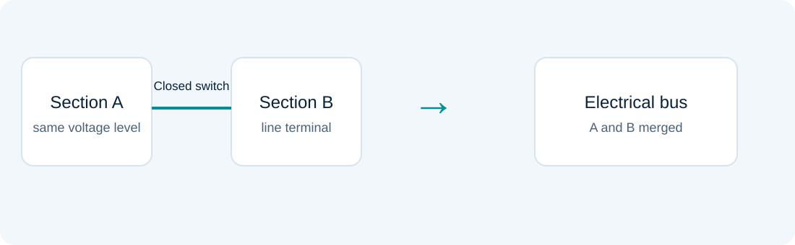

# Generalized and parameter estimation

### Lesson 10 · Topology, parameters, and model errors

Graduate course · University of São Paulo · Prof. João Bosco A. London Junior

---

## Two extensions of conventional estimation

The first block treats **topology** using a generalized representation. The second presents **line-parameter validation** through joint state and parameter estimation.

Both question the assumption that the network model supplied to the estimator is entirely correct.

---

## Analog, topology, or parameter error?

| Error | Affected information | Model effect |
|---|---|---|
| Analog | Channel reading | Changes $z$ |
| Topology | Device status | Changes connections and equations |
| Parameter | Impedance, tap, or shunt | Changes coefficients of $h$ |

An abnormal residual pattern does not, by itself, identify which cause occurred.

---

## Conventional substation reduction

Ideal closed devices merge sections into equivalent buses. Open devices interrupt connections.

After reduction, internal details are no longer explicit. Incorrect status can misassociate equipment and measurements.

---

## Generalized representation

Retain relevant sections and devices rather than imposing the complete bus–branch reduction beforehand.

An expanded representation can include section voltages, device flows, and constraints corresponding to assumed switch states.

Greater detail requires additional variables and careful constraint handling.

---

## Ideal closed or open device

For an ideal closed connection:

$$V_i=V_j,\qquad\theta_i=\theta_j$$

For an open device, through-device flows are zero.

Insert these relationships according to the chosen formulation. Replacing an ideal switch with an arbitrarily small impedance can cause conditioning problems.

---

## Constrained formulation

One conceptual formulation is:

$$\min_x[z-h(x)]^TR^{-1}[z-h(x)]\quad\text{subject to }c(x)=0$$

Constraints encode exact physical relationships adopted in the model. Multipliers and augmented systems can replace artificially infinite weights.

---

## Dimension and available information

Adding variables without independent equations or constraints may destroy identifiability.

Check rank, redundancy, and consistency of device assumptions. Generalization does not create information where measurements or physical relationships are insufficient.

---

## Line parameters

In the π model, series and shunt parameters affect flows and injections:

$$p=[g_{ij},b_{ij},b_{ij}^{sh},\ldots]^T$$

A parameter error may affect several channels at the branch terminals and nearby. This is a distributed effect, unlike changing one entry of $z_i$.

---

## Joint state and parameter model

$$z=h(x,p)+e$$

$$\Delta z\simeq H_x\Delta x+H_p\Delta p$$

Columns of $H_p$ describe sensitivities to unknown parameters. If dependent on other columns, data cannot separate state error from parameter error.

---

## Methodology in the second block

The parameter-validation study has three phases:

1. Identify suspect branches.
2. Estimate suspect parameters.
3. Validate the resulting estimates.

The study is *offline* and uses several operating-data samples.

---

## Phase 1 · Identify suspect branches

Use conventional estimation and normalized residuals to locate persistent inconsistencies.

The method's suspicion index guides branch selection, limiting parameter augmentation. Selection must account for error effects spreading to neighboring measurements.

---

## Phase 2 · Estimate the parameters

Include only selected parameters in the augmented vector:

$$\xi=\begin{bmatrix}x\\p_{\mathrm{suspect}}\end{bmatrix}$$

Solve the corresponding normal equations. Reassess observability and conditioning: a sufficient measurement set for the original problem may be insufficient after augmentation.

---

## Why do multiple samples help?

States change between instants; physical parameters may remain approximately constant within a window.

$$z_t=h(x_t,p)+e_t$$

$$\min_{p,x_1,\ldots,x_T}\sum_t\|z_t-h(x_t,p)\|_{R_t^{-1}}^2$$

This expression summarizes shared parameter information. The material presents a sequential implementation using earlier estimates.

---

## Diversity of operating points

Repeating a condition with weak parameter sensitivity may add little identification information.

Loading changes can make sensitivities more informative. The window must also remain compatible with the constant-parameter assumption.

---

## Phase 3 · Validate corrections

Reassess residuals and model consistency after incorporating parameter estimates.

A lower objective alone is insufficient physical justification: the model gained degrees of freedom. Check parameter plausibility, repeatability across samples, and effects on channels not used as primary evidence.

---

## Error spreading and false suspicion

A branch with incorrect parameters can produce residuals on other branches. Validation helps avoid interpreting every affected channel as evidence of another incorrect parameter.

Similarly, untreated analog bad data can contaminate parameter inference.

---

## Studies presented in the course

The material discusses IEEE systems and Hydro-Québec subsystems, comparing parameter-error diagnosis and correction.

Distinguish tests with known injected errors from real-data studies. “True” parameters and validation criteria are not equally available in both settings.

---

## Interpretation exercise

Consider persistent abnormal residuals at both terminals of a line. List possible analog, channel-orientation, topology, and parameter errors.

Which additional readings or temporal comparisons would distinguish these hypotheses? Justify a diagnosis before changing a database parameter.

---

## Textbook foundations · Joint rank is the real requirement

With uncertain parameters $p$, linearize both sets of unknowns:

$$\Delta z\simeq H_x\Delta x+H_p\Delta p+e$$

Full rank of $H_x$ does not establish identifiability of $p$. A parameter change may be indistinguishable from a state change.

A parameter prior can stabilize the solution, but stability supplied by a prior must be distinguished from information supplied by measurements.

Reading: [AE04] §§7.6 and 7.9; [M99] §11.2.

---

## Eliminate the state to expose parameter information

Let $G_x=H_x^TWH_x$ be nonsingular. After eliminating $\Delta x$, the measurement information about $p$ is:

$$\mathcal I_p=H_p^TWH_p-H_p^TWH_xG_x^{-1}H_x^TWH_p$$

Equivalently, for $A_x=W^{1/2}H_x$ and $A_p=W^{1/2}H_p$:

$$\mathcal I_p=A_p^T(I-\Pi_x)A_p$$

Only parameter effects outside the state-sensitivity subspace are separable. An independent parameter prior adds its precision matrix to $\mathcal I_p$.

Reading: [M99] §11.2.1, PDF pp. 300–301; [AE04] §7.9.

---

## Multiple operating points can separate parameters

Consider $Q_k=d+fV_k^2+e_k$, with constant unknown $d,f$ and voltage treated as known in this illustration:

$$H_p=\begin{bmatrix}1&V_1^2\\\vdots&\vdots\\1&V_s^2\end{bmatrix}$$

If all voltages are equal, the columns are dependent: only $d+fV^2$ is identified. Distinct voltage magnitudes provide excitation; a very small voltage range can still leave poor conditioning.

Repeated identical conditions improve the precision of an identifiable combination, without separating the two coefficients.

Reading: [M99] §11.2, PDF pp. 302–305. Simplified derivation inspired by its voltage-dependent load example.

---

## Parameter and topology errors change the model

A wrong line parameter changes measurement sensitivities and can distribute residuals across many channels. Removing the largest residual can discard a healthy measurement without correcting the model.

An incorrect breaker status can change connectivity and the appropriate state description. Generalized estimation represents additional physical detail to test these alternatives.

Validate a proposed correction through electrical consistency, sufficient parameter/topology information, and renewed residual analysis. A better fit alone can favor an overparameterized model.

Reading: [AE04] Chapters 7–8; [M99] Chapter 6; [BLC] §§2.4 and 7.5.

---

## Textbook reading for this lesson

**[AE04]** Abur & Gómez Expósito, *Power System State Estimation: Theory and Implementation* (2004). Chapters 7–8.

**[M99]** Monticelli, *State Estimation in Electric Power Systems: A Generalized Approach* (1999). Chapter 6 and §11.2.

**[BLC]** Bretas, London Jr. & Carvalho, *Estimação de Estado em Sistemas Elétricos de Potência* (course manuscript; cover 2019, supplied file version 2020). §§2.4, 7.5.

Section numbers identify the original work; any PDF page numbers are 1-based file pages. Added explanations and derivations use this site’s notation. Explicitly labeled extensions are teaching examples.

---

## Sources and further study

- Aula 10 - Conceitos - Estimador Generalizado - 22 10 24.pdf
- Aula 10 - Estimador de Estado e Parâmetros Madeleine - EDAO 2010 - 22 10 24 (1).pdf

Educational adaptation in Markdown and LaTeX, with redrawn figures. The lesson and topic-block sequence is preserved; repeated animation steps are consolidated.
