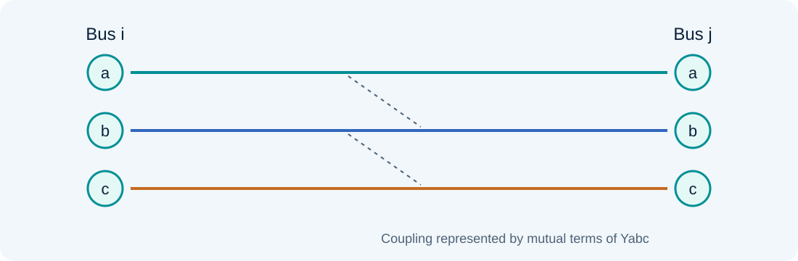
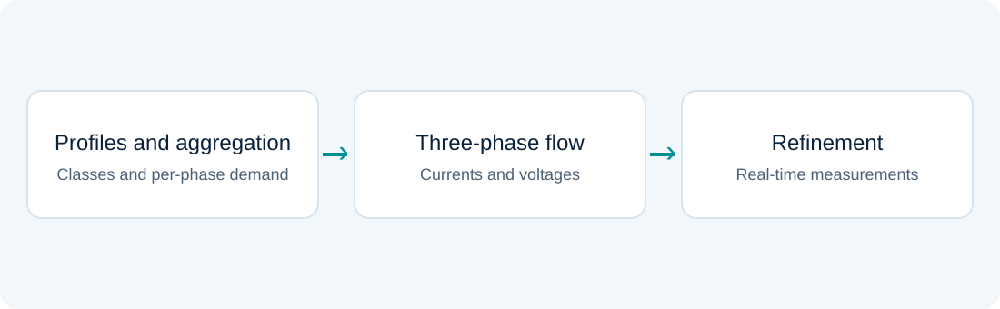
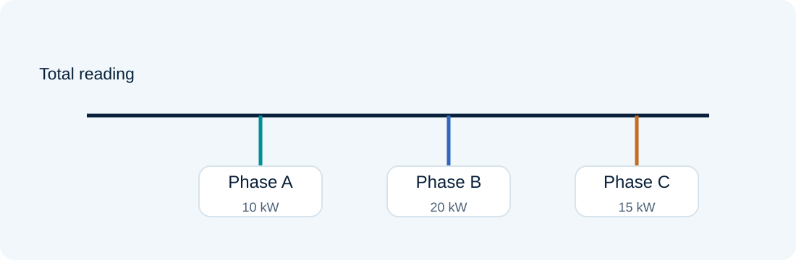

# Distribution and three-phase demand estimation

### Lesson 11 · Pseudomeasurements, unbalance, and load aggregation

Graduate course · University of São Paulo · Prof. João Bosco A. London Junior

---

## Lesson outline

1. Distinctive features of distribution estimation.
2. WLS, power-flow methods, branch-current states, and admittance-based methods.
3. Three-phase modeling and observability.
4. Real-time three-phase demand estimation (EDTTR in the source material).

The final laboratory develops a per-phase demand-refinement example motivated by the last block.

---

## Why is distribution different?

There are fewer real-time measurements, more buses, and greater reliance on estimated load information.

Radiality, unbalance, high $R/X$, single-phase laterals, and connection details affect modeling. Approximations effective in transmission require reassessment.

---

## Physical readings and pseudomeasurements

Substation, feeder, smart-meter, and local-device measurements may coexist with historical consumption profiles.

A pseudomeasurement is uncertain information, not a precise observation to which an arbitrarily large weight can be assigned merely to make a problem solvable.

---

## WLS in distribution

$$z=h(x)+e,\qquad\min_x[z-h(x)]^TR^{-1}[z-h(x)]$$

The formulation is familiar; network representation, state variables, data quality, and covariance structure change.

A single-phase equivalent may be inadequate when unbalance is significant.

---

## Power-flow-based estimators

Start with estimated demands, run power flow, and compare with available readings. Update demands and repeat according to the method's criterion.

Backward/forward sweeps suit radial networks. The adjustment procedure must specify how uncertainty and real-time data are incorporated.

---

## Branch currents as states

Using branch-current components can simplify relationships with certain measurements in radial feeders.

Power demands are converted into current information using available voltages. Because that transformation depends on estimated voltages, the model and precision require updates during solution.

---

## Admittance-matrix-based estimators

Formulations based on $Y$ relate injections and voltages and can exploit operating-point updates.

When comparing AMB and branch-current approaches, examine variables, linearizations, pseudomeasurements, and constraints. A simple numerical structure is not proof of equivalence to the original WLS problem.

---

## Three phases and coupling

$$\mathbf V_i=[V_i^a,V_i^b,V_i^c]^T$$

$$\mathbf I_{ij}=Y_{ij}^{abc}(\mathbf V_i-\mathbf V_j)$$

Off-diagonal terms represent interphase coupling. Neutral conductors, load connections, and transformers require appropriate models.

---

## Three-phase injections

For phase $\phi$ at bus $i$:

$$S_i^\phi=V_i^\phi\left(\sum_{j,\psi}Y_{i\phi,j\psi}V_j^\psi\right)^*$$

A phase's power equations may depend on other phases' voltages. The Jacobian must represent these couplings.

---

## Per-phase polar model

$$P_i^\phi=V_i^\phi\sum_{j,\psi}V_j^\psi
\left(G_{i\phi,j\psi}\cos\theta_{i\phi,j\psi}+B_{i\phi,j\psi}\sin\theta_{i\phi,j\psi}\right)$$

$$Q_i^\phi=V_i^\phi\sum_{j,\psi}V_j^\psi
\left(G_{i\phi,j\psi}\sin\theta_{i\phi,j\psi}-B_{i\phi,j\psi}\cos\theta_{i\phi,j\psi}\right)$$

The summation covers the phase nodes actually present in the representation.

---

## States and references in three-phase models

With $N$ complex phase nodes, a generic polar representation has up to $2N$ variables before fixing references and source conditions.

The final count depends on known substation voltages and physical connections. Do not fix three independent angle references without justifying the coupling model.

---

## Three-phase observability

The rank test still applies to the complete model's Jacobian, with its references and constraints.

A single-phase equivalent can conceal missing information in one phase. Aggregate power readings are not equivalent to three independent per-phase readings.

---

## Correlated pseudomeasurements

Profiles sharing temperature, customer-class, or time-of-day factors can have correlated errors.

A diagonal covariance may be useful, but is an assumption. Counting correlated profiles as independent information tends to overstate precision.

---

## Practical modeling challenges

- Incomplete device status and topology errors.
- Poorly documented secondary-network parameters.
- Microgrids, distributed generation, and reverse flows.
- Large scale and mixed data rates or delays.

More channels do not remove the need to validate associations and models.

---

## EDTTR: three-stage overview

The material combines typical profiles, load aggregation, three-phase power flow, and demand refinement using real-time information.

---

## Stage 1 · Individual typical profiles

Assign each customer a class and a profile compatible with consumption information. Scale the individual profile and identify its phase/connection.

Accumulated energy consumption helps scale the curve, but does not uniquely determine instantaneous demand or power factor.

---

## Customer aggregation

$$\mu_{P,\mathrm{agg}} =\sum_i\mu_{P,i}$$

$$\sigma_{P,\mathrm{agg}}^2=\sum_i\sigma_{P,i}^2+2\sum_{i<j}\operatorname{Cov}(P_i,P_j)$$

Under independence, variances add. Do not add standard deviations as though every demand varied perfectly together.

---

## Stage 2 · Three-phase power flow

With aggregated demands, sweep per-phase currents. Accumulate currents backward and update voltages forward using each branch's impedance matrix.

Recalculate voltage-dependent load currents at every iteration. Check convergence and losses.

---

## Stage 3 · Real-time refinement

Organize metering areas and compare measured and calculated powers. Their differences guide demand adjustments.

Avoid double-counting information between overlapping areas and respect customer-to-phase associations.

---

## The example's metering area

One total reading relates three demands. It does not determine each phase alone; initial estimates provide complementary information.

---

## Teaching example: one area, three phases

Consider initial active demands in kW:

$$\mu=[10,20,15]^T,\qquad D=\operatorname{diag}(4,9,4)$$

The measured total is $z=54$ kW, with standard deviation 1 kW. Neglect area losses to isolate demand refinement.

This original teaching example is inspired by the refinement stage. It does not reproduce the source study's experimental feeders.

---

## WLS demand adjustment

$$\min_p (p-\mu)^TD^{-1}(p-\mu)+\frac{(z-\mathbf1^Tp)^2}{r}$$

$$\hat p=\mu+\frac{D\mathbf1}{\mathbf1^TD\mathbf1+r}(z-\mathbf1^T\mu)$$

$r=1$ kW$^2$. More uncertain phases receive a larger correction because their initial values are less precise.

---

## Example result and uncertainty

$$\hat p=[12,24.5,17]^T\ \mathrm{kW}$$

$$D_{post}=D-\frac{D\mathbf1\mathbf1^TD}{\mathbf1^TD\mathbf1+r}$$

The estimated total is 53.5 kW. It is not forced to 54 kW because the total measurement also has finite uncertainty.

The adjustment introduces correlations between phase estimates.

---

## Assessment presented in the source material

The EDTTR study presents simulations on the IEEE 34-bus feeder and a real 133-bus CPFL feeder.

Compare initial/refined estimates, best/worst cases, and measured/calculated powers. Do not transfer these studies' performance to the aggregate example without checking assumptions.

---

## Sources and further study

- Aula 11 - Estimadores de Estado em Sistemas de Distribuição - 29 10 24.pdf
- Aula 11 - Estimador de Demanda Trifásico - Qual_Luana_disciplina - 29 10 24.pdf

Educational adaptation in Markdown and LaTeX, with redrawn figures. The lesson and topic-block sequence is preserved; repeated animation steps are consolidated.

---

## Laboratory guide · Refinement and weights

Vary the total power reading and its precision. Compare phase adjustments, estimated totals, and prior/posterior standard deviations.

**Questions:** what happens with an imprecise total reading? Why does phase B receive a larger correction? When does the estimated total approach the reading more closely?

The experiment estimates aggregated active demands; it does not calculate feeder losses or three-phase voltages.
