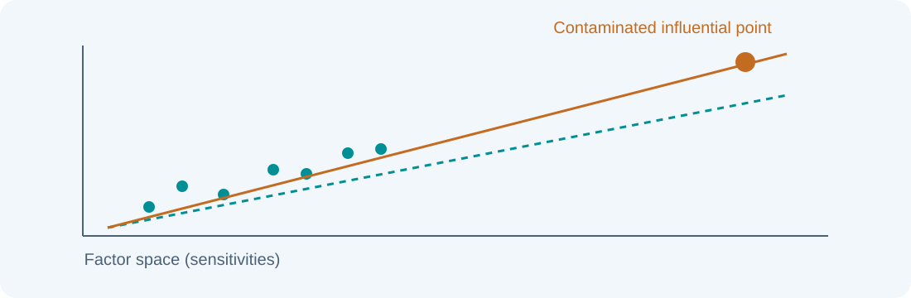
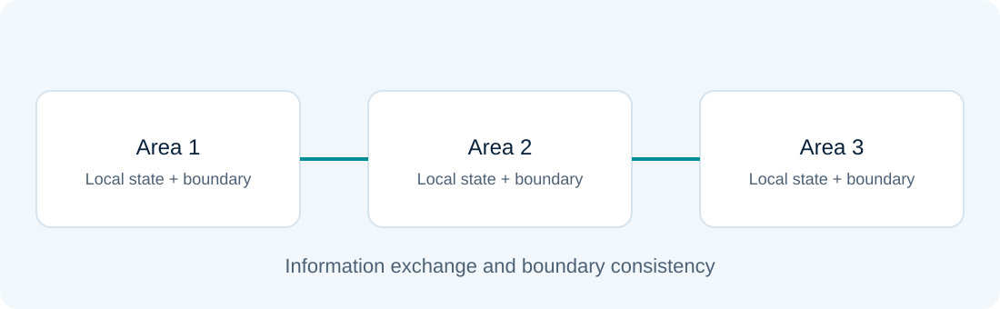

# Robust and multi-area state estimation

### Lesson 12 · WLS limitations and coordination between areas

Graduate course · University of São Paulo · Prof. João Bosco A. London Junior

---

## Outline: robustness and coordination

The first block addresses WLS limitations, WLAV, WLMS, and leverage points. The second covers multi-area estimation and coordination architectures.

The final laboratory compares WLS with robust reweighting in an extension of Assignment 2's linear exercise.

---

## When Gaussian assumptions fail

WLS is efficient under its statistical model, but squared residuals give large discrepancies substantial influence.

$$J_{WLS}=\sum_i u_i^2,\qquad u_i=\frac{z_i-h_i(x)}{\sigma_i}$$

A bad measurement may move the solution before residual post-processing attempts to identify it.

---

## Robustness is not observability

Critical measurements and unobservable directions represent missing independent information.

Changing the objective cannot create that information. An indispensable but incorrect reading may still determine a state direction across different estimators.

---

## Weighted least absolute value: WLAV

$$\min_x\sum_i\frac{|z_i-h_i(x)|}{\sigma_i}$$

The penalty grows linearly in the tails. Here scaling uses standard deviation; translate other weighting conventions before comparing formulas.

The function is nondifferentiable at zero and requires an appropriate algorithm.

---

## Linear WLAV as a linear program

Introduce nonnegative variables $r^+,r^-$:

$$\min_{x,r^+,r^-}\sum_i\frac{r_i^++r_i^-}{\sigma_i}$$

$$Hx+r^+-r^-=z,\qquad r^+,r^-\ge0$$

For nonlinear models, successive linearizations require updates and additional convergence criteria.

---

## WLAV limitations

Limiting large-residual influence does not protect against every bad-data pattern. Leverage points and critical configurations remain relevant.

Assess measurement geometry and contamination scenarios, not only the loss function's shape.

---

## Weighted least median of squares: WLMS

$$\min_x\operatorname{median}_i\left[\left(\frac{z_i-h_i(x)}{\sigma_i}\right)^2\right]$$

Focusing on the median limits the influence of some large residuals. However, the search can be combinatorial and expensive, particularly for real-time applications.

Robustness and statistical efficiency are different criteria.

---

## Leverage points

A point stands out in factor space: its sensitivities differ from other rows of the weighted Jacobian.

A clean leverage point may be informative; a contaminated one can attract the fit and mask its own residual.

---

## Hat matrix in whitened coordinates

$$A=R^{-1/2}H,\qquad P=A(A^TA)^{-1}A^T$$

$P$ is symmetric and idempotent. Its diagonal measures each observation's local leverage:

$$0\le P_{ii}\le1,\qquad\sum_iP_{ii}=n$$

For diagonal $R$, $P_{ii}=K_{ii}$ in the earlier notation.

---

## A small residual can hide strong influence

$$\operatorname{Var}(r_i/\sigma_i)=1-P_{ii}$$

As $P_{ii}$ approaches 1, the fit can strongly absorb the measurement. UI increases as $\sqrt{P_{ii}/(1-P_{ii})}$.

The diagonal provides useful geometric diagnostics; it does not establish the presence of bad data by itself.

---

## Leverage in power systems

Jacobian rows depend on reactances, measurement types, and sensor locations. Changing one reactance affects several channels' sensitivities.

The material illustrates how parameter changes move measurements in factor space. Weight changes also alter the weighted geometry.

---

## Supplement: Huber loss

A transition between quadratic and linear penalties is:

$$\rho_c(u)=\begin{cases}\tfrac12u^2,&|u|\le c\\c|u|-\tfrac12c^2,&|u|>c\end{cases}$$

The parameter $c$ determines where influence stops growing linearly with the residual. The laboratory uses this teaching extension without replacing WLAV and WLMS coverage.

---

## Iteratively reweighted least squares: IRLS

For Huber loss:

$$a_i=\min\left(1,\frac{c}{|u_i|}\right)$$

$$W_{\mathrm{eff}}=\operatorname{diag}\left(\frac{a_i}{\sigma_i^2}\right)$$

Solve WLS, update residuals, and repeat. Set $a_i=1$ when $u_i=0$ and check solution convergence.

---

## Assessing a robust estimator

Compare clean, single-error, multiple-error, interacting-error, and high-leverage contamination cases.

Report bias, RMSE, convergence, and computational cost. Do not compare objective values alone: WLS, WLAV, and Huber minimize different criteria.

---

## Why multi-area estimation?

Partition a large system into areas with local processing. Coordination must make boundary information consistent.

Objectives include distributing computation, organizing information, and accommodating different data-availability levels.

---

## Types of overlap

- Nonoverlapping areas: no shared buses or branches.
- Boundary-bus overlap: shared interconnection buses.
- Extended overlap: several shared buses and branches may exist.

Partitioning determines which states and measurements need a shared representation.

---

## An area's measurement model

$$z_k=h_k(x_k,x_{\mathrm{boundary}})+e_k$$

Some equations involve local variables; others connect neighboring areas. Duplicated equivalent states require consistency constraints.

Local angle references need a mechanism to make them compatible.

---

## Centralized problem and decomposition

For independent, nonduplicated measurement sets:

$$J(x)=\sum_k[z_k-h_k(x)]^TR_k^{-1}[z_k-h_k(x)]$$

Decomposition separates internal and boundary contributions. Any inter-area correlation must be represented in the global covariance.

---

## Hierarchical coordination

Areas first produce local estimates. A coordination stage then adjusts boundary information to reconcile the solutions.

Specify which values and covariances are transmitted. Treating a measurement and its derived estimate as independent double-counts information.

---

## Distributed coordination

Neighboring areas exchange information and update states without a single central coordinator.

Consistency criteria, iteration synchronization, delays, and communication losses affect the process. Algorithm convergence and measurement freshness require separate checks.

---

## Distribution-system applications

The material discusses architectures combining substations, primary networks, and secondary networks with different measurement densities and load models.

PMU information, smart-meter data, and probabilistic profiles can be integrated through suitable area modules. Every source's uncertainty must accompany the exchange.

---

## Connecting to dynamic estimation

The course has connected modeling and topology, estimation, bad-data processing, observability, measurement planning, and estimator extensions. Lesson 13 adds temporal evolution models.

**When interpreting any result, ask:** which data and assumptions produced it, what information is redundant, which errors are detectable, and under what conditions is the solution reliable?

---

## Textbook foundations · From a loss to estimating equations

For independent channels, define $u_i=r_i/\sigma_i$ and minimize $\sum_i\rho(u_i)$. With $\psi=\rho'$:

$$H^T\operatorname{diag}(\sigma_i^{-1})\psi(u)=0$$
$$w_i^{\mathrm{IRLS}}=\frac{1}{\sigma_i^2}\frac{\psi(u_i)}{u_i}$$

For Huber loss, $\psi(u)=\operatorname{clip}(u,-c,c)$; the ratio at zero is defined by its limit, 1. IRLS repeatedly solves the corresponding weighted problem.

Reading: [AE04] §§6.4–6.4.2; [BLC] §4.6.

---

## Huber loss: what the guarantee covers

Huber loss is convex in a linear residual, so the linear-model objective is convex. An AC residual $z-h(x)$ generally produces a nonconvex objective even with the same loss.

Clipping large residuals controls their direct score contribution. It does not automatically control the influence of a high-leverage observation whose fitted residual is small.

**Laboratory:** inject a bias and vary the channel's precision. Compare parameter error as well as the final residual and robust weight.

Reading: [AE04] §§6.3–6.4; [BLC] §4.6 and Appendix A.

---

## Breakdown and uncertainty need separate definitions

A finite-sample replacement breakdown point can be defined as the smallest fraction of replaced observations that can drive an estimate arbitrarily far. Other texts report the largest tolerated fraction; state the convention before quoting a number.

Bounded residual scores alone do not ensure high breakdown when the design contains vulnerable leverage directions.

After robust fitting, simply inverting the final weighted gain generally does not provide a calibrated sampling covariance. Appropriate robust uncertainty analysis must account for the loss, weights, and error model.

Reading: [AE04] §§6.2–6.4; [BLC] Appendices A–B. Uncertainty caution follows from data-dependent weights.

---

## Multi-area coordination as boundary elimination

For one area's quadratic linearization, partition internal variables $u$ and boundary variables $v$:

$$\begin{bmatrix}G_{uu}&G_{uv}\\G_{vu}&G_{vv}\end{bmatrix}\begin{bmatrix}\Delta u\\\Delta v\end{bmatrix}=\begin{bmatrix}b_u\\b_v\end{bmatrix}$$
$$S_v=G_{vv}-G_{vu}G_{uu}^{-1}G_{uv},\qquad \tilde b_v=b_v-G_{vu}G_{uu}^{-1}b_u$$

The area can pass reduced boundary information to a coordinator. Shared measurements and priors must be counted once. Local elimination requires nonsingular internal blocks and a consistent common model.

Reading: course multi-area lecture; [M99] §§5.3 and 5.11. This is a derived coordination example, not a claim of a dedicated textbook multi-area chapter.

---

## Textbook reading for this lesson

**[AE04]** Abur & Gómez Expósito, *Power System State Estimation: Theory and Implementation* (2004). §§6.2–6.4.2.

**[M99]** Monticelli, *State Estimation in Electric Power Systems: A Generalized Approach* (1999). §§5.3, 5.11.

**[BLC]** Bretas, London Jr. & Carvalho, *Estimação de Estado em Sistemas Elétricos de Potência* (course manuscript; cover 2019, supplied file version 2020). §4.6 and Appendices A–B.

Section numbers identify the original work; any PDF page numbers are 1-based file pages. Added explanations and derivations use this site’s notation. Explicitly labeled extensions are teaching examples.

---

## Sources and further study

- Aula 12 - Estimação Robusta Estatisticamente - 12 11 24.pdf
- Aula 12 -  Estimação de Estado Multiárea - 12 11 24.pdf

Educational adaptation in Markdown and LaTeX, with redrawn figures. The lesson and topic-block sequence is preserved; repeated animation steps are consolidated.

---

## Laboratory guide · Contaminating Assignment 2

Use Exercise 1's original six equations and readings. Add a controlled bias to $P_{12}$ and compare WLS with Huber.

Observe the estimate, standardized residuals, and robust weight assigned to the modified channel.

The extension retains the assignment's $\sigma$ scale. It does not provide complete protection against leverage points.
