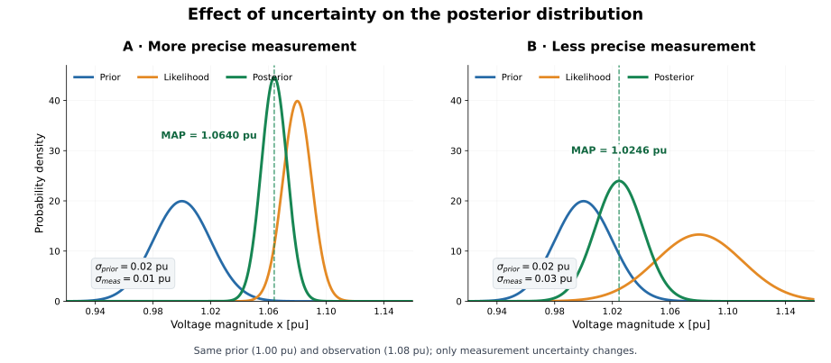
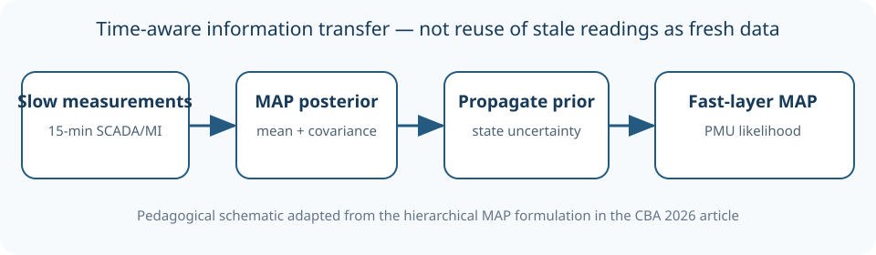

# Dynamic State Estimation: From Maximum Likelihood to Bayesian MAP Fusion

### Lesson 13 · Foundations, asynchronous measurements, intermittent PV, and case study

Graduate course · EESC–USP · Expanded teaching adaptation of Massignan and London Jr. (2024)

---

## Learning outcomes

By the end of this lesson, you should be able to:

1. Derive ML, MAP, and MMSE estimators and compare their assumptions.
2. Obtain Gaussian MAP as a weighted nonlinear least-squares problem.
3. Derive the MAP Gauss–Newton correction and its information matrix.
4. Explain the relation between MAP, the Kalman filter, and temporal prediction.
5. Distinguish **asynchronous measurement layers** from physical dynamic-state estimation.
6. Interpret the methodology and findings of the intermittent-PV CBA 2026 case study.

---

## Why are repeated static snapshots insufficient?

Conventional state estimation (SE) treats the measurements of a scan as if they represented one operating condition:

$$z_k=h(x_k)+e_k.$$

In high-PV systems, operating conditions may change substantially between low-rate measurements. A recent PMU observation and a 15-minute-old smart-meter value do **not** represent the same instant.

**Guiding question:** How do we combine information acquired at different times *without pretending that old measurements are new*?

---

## What is being estimated?

For an AC network with $n_b$ buses and one angular reference:

$$x=[\theta_2,\ldots,\theta_{n_b},V_1,\ldots,V_{n_b}]^T.$$

The quasi-static network state is a vector of voltage phasor coordinates. In electromechanical DSE, the state can instead include rotor angles, speeds, controller states, and other dynamic variables.

**Do not conflate:** time-varying algebraic network state tracking and physics-based dynamic-state estimation.

---

## Three types of information

- **Likelihood:** what do the current measurements say about $x$?
- **Prior:** what did we already know about $x$, before processing these measurements?
- **Posterior:** what should we believe about $x$ *after* combining both?

$$p(x\mid z)=\frac{p(z\mid x)p(x)}{p(z)}.$$

For a fixed observed $z$, the evidence $p(z)$ normalizes the distribution but does not change its maximizer.

---

## Maximum likelihood (ML)

$$\hat x_{\mathrm{ML}}=\arg\max_x p(z\mid x).$$

For $z=h(x)+e$, with $e\sim\mathcal N(0,R)$ and $R\succ0$:

$$-2\log p(z\mid x)=\|z-h(x)\|_{R^{-1}}^2+\mathrm{const}.$$

Thus:

$$\boxed{\hat x_{\mathrm{ML}}=\arg\min_x\|z-h(x)\|_{R^{-1}}^2}.$$

This is the conventional WLS estimator under the stated Gaussian model. [1]

---

## Where does the covariance matrix enter?

$$\|r\|_{R^{-1}}^2=r^TR^{-1}r.$$

If $R=\operatorname{diag}(\sigma_1^2,\ldots,\sigma_m^2)$:

$$J_{\mathrm{ML}}=\sum_{i=1}^m\frac{[z_i-h_i(x)]^2}{\sigma_i^2}.$$

More accurate measurements have smaller variances and greater statistical influence. Correlated measurement errors require the **full covariance**, not only its diagonal.

---

## Linear ML: uniqueness and observability

For $z=Hx+e$:

$$\hat x_{\mathrm{ML}}=(H^TR^{-1}H)^{-1}H^TR^{-1}z.$$

The inverse exists when $H$ has full column rank. If $Hv=0$ for $v\ne0$, no measurement distinguishes $x$ from $x+v$.

This connects Lesson 13 to the course's observability lectures.

---

## Nonlinear ML and Gauss–Newton

At the current iterate $x^{(j)}$:

$$h(x^{(j)}+\Delta x)\approx h(x^{(j)})+H_j\Delta x,$$

$$H_j=\left.\frac{\partial h}{\partial x}\right|_{x^{(j)}}.$$

The WLS correction solves:

$$H_j^TR^{-1}H_j\Delta x=H_j^TR^{-1}[z-h(x^{(j)})].$$

A full-column-rank Jacobian guarantees positive-definite local Gauss–Newton curvature, **not global convergence**. [1]

---

## What changes with a prior?

Suppose independent prior information gives:

$$x\sim\mathcal N(\mu^-,P^-),\qquad P^-\succ0.$$

Then:

$$p(x)\propto\exp\!\left[-\frac12\|x-\mu^-\|_{(P^-)^{-1}}^2\right].$$

The prior is *uncertain information*, not an exact equality $x=\mu^-$. Its precision matrix $(P^-)^{-1}$ sets its influence.

---

## Maximum a posteriori (MAP)

$$\boxed{\hat x_{\mathrm{MAP}}=\arg\max_x p(x\mid z)}$$

Bayes' rule gives:

$$\hat x_{\mathrm{MAP}}=\arg\max_x\{\log p(z\mid x)+\log p(x)\}.$$

For independent Gaussian measurement and prior errors:

$$\boxed{J_{\mathrm{MAP}}(x)=\|z-h(x)\|_{R^{-1}}^2+\|x-\mu^-\|_{(P^-)^{-1}}^2}.$$

This is the core mathematical bridge to the CBA 2026 article. [1], [2]

---

## How to interpret the MAP objective

$$J_{\mathrm{MAP}}=\underbrace{(z-h(x))^TR^{-1}(z-h(x))}_{\text{measurement consistency}}+\underbrace{(x-\mu^-)^T(P^-)^{-1}(x-\mu^-)}_{\text{prior consistency}}.$$

- Small $R$: current measurements strongly constrain the solution.
- Small $P^-$: the prior strongly constrains the solution.
- Large $P^-$: the prior becomes less informative and MAP approaches ML when ML is identifiable.

**Question:** what happens when the prior is highly confident but outdated by a sudden PV change?

---

## A scalar example the class can solve

Assume a prior $x\sim\mathcal N(1.00,0.02^2)$ and a new observation $z=1.08$ with $\sigma_z=0.01$.

$$J(x)=\frac{(1.08-x)^2}{0.01^2}+\frac{(x-1.00)^2}{0.02^2}.$$

The Gaussian posterior mean/mode is:

$$\hat x=\frac{1.08/0.01^2+1.00/0.02^2}{1/0.01^2+1/0.02^2}=1.064.$$

It lies between the two observations of information; the smaller measurement variance gives the new reading more influence.

---

## Effect of uncertainty on the posterior distribution

The prior and measured value are unchanged. A more precise measurement moves the posterior toward $z$; a less precise measurement leaves it closer to $\mu^-$. In this Gaussian example, **MAP = posterior mean**.

Note: Ask students to compare the two posterior peaks before revealing the explanation. Both cases use $\mu^-=1.00$ pu, $\sigma_p=0.02$ pu, and $z=1.08$ pu. Case A has $\sigma_z=0.01$ pu ($\hat x_{MAP}=1.0640$ pu); Case B has $\sigma_z=0.03$ pu ($\hat x_{MAP}\approx1.0246$ pu). The curves are probability densities, not independent voltage measurements.

---

## Gaussian MAP: general linear solution

For $z=Hx+e$ with $e\sim\mathcal N(0,R)$:

$$G_{\mathrm{MAP}}=H^TR^{-1}H+(P^-)^{-1},$$

$$\boxed{\hat x_{\mathrm{MAP}}=G_{\mathrm{MAP}}^{-1}\big[H^TR^{-1}z+(P^-)^{-1}\mu^-\big]}.$$

$$\boxed{P^+=(G_{\mathrm{MAP}})^{-1}}.$$

A proper positive-definite prior makes the posterior Hessian nonsingular even if the current measurement set alone is insufficient. **This does not mean the measurements have become physically observable.**

---

## Deriving nonlinear MAP with Gauss–Newton

Let $r_j=z-h(x^{(j)})$, $d_j=\mu^--x^{(j)}$, and $H_j=\partial h/\partial x$.

Linearizing the measurement equation leads to:

$$\big(H_j^TR^{-1}H_j+(P^-)^{-1}\big)\Delta x=$$
$$H_j^TR^{-1}r_j+(P^-)^{-1}d_j.$$

Update $x^{(j+1)}=x^{(j)}+\Delta x$ until convergence. Solve the linear system by factorization; do not explicitly construct matrix inverses in numerical code.

---

## MAP is regularized WLS

The prior penalty corresponds to an additional Gaussian information term:

$$\tilde z=\begin{bmatrix}z\\\mu^-\end{bmatrix},\quad\tilde h(x)=\begin{bmatrix}h(x)\\x\end{bmatrix},\quad\tilde R=\begin{bmatrix}R&0\\0&P^-\end{bmatrix}.$$

This augmented model recovers the MAP objective, provided the assumed cross-covariance is zero.

**Caution:** a posterior already conditioned on a measurement must not be reused as an independent prior *and* paired again with the same measurement: that would double-count information.

---

## MAP versus MMSE

$$\hat x_{\mathrm{MAP}}=\arg\max_x p(x\mid z),\qquad\hat x_{\mathrm{MMSE}}=\mathbb E[x\mid z].$$

MAP is the **posterior mode**; MMSE is the **posterior mean**. They coincide when the posterior is Gaussian. They can differ substantially for skewed or multimodal posteriors.

The ordinary linear-Gaussian Kalman filter yields both at once. [1]

---

## Probability is not the same as robustness

A Gaussian MAP estimator still uses a quadratic penalty and can be sensitive to outliers and biased data.

A robust Bayesian alternative may change the likelihood (e.g., a heavy-tailed error model) or introduce latent outlier variables. It is **not sufficient** simply to rename a Gaussian prior 'robust'.

Zhao, Netto, and Mili discuss robust estimation and robust filtering, including GM-based methods. [3]

---

## Temporal information: state transition model

A sequential estimator needs a model that takes information from time $k-1$ to $k$:

$$x_k=f_{k-1}(x_{k-1},u_{k-1})+w_{k-1},$$

$$z_k=h_k(x_k)+e_k.$$

The transition model and its covariance $Q$ reflect assumed temporal evolution. A random walk is a tracking model, not a full physical generator or inverter model.

---

## Prediction: where the next prior comes from

For a linear transition:

$$\mu_k^-=F_{k-1}\hat x_{k-1}^++B_{k-1}u_{k-1},$$

$$P_k^-=F_{k-1}P_{k-1}^+F_{k-1}^T+Q_{k-1}.$$

A measurement update at time $k$ solves the MAP problem using $(\mu_k^-,P_k^-)$ as the prior. The posterior becomes the input for the next prediction.

---

## Gaussian MAP and the Kalman update agree

For $z_k=H_kx_k+e_k$:

$$S_k=H_kP_k^-H_k^T+R_k,$$

$$K_k=P_k^-H_k^TS_k^{-1},$$

$$\hat x_k^+=\mu_k^-+K_k(z_k-H_k\mu_k^-).$$

This has exactly the same state estimate as linear Gaussian MAP. The Joseph covariance update helps preserve numerical symmetry and positivity.

---

## The innovation is a diagnostic quantity

$$\nu_k=z_k-H_k\mu_k^-,\qquad S_k=H_kP_k^-H_k^T+R_k.$$

For an appropriately specified Gaussian model:

$$\mathrm{NIS}_k=\nu_k^TS_k^{-1}\nu_k.$$

Unexpectedly large innovations may indicate an outlier, a model mismatch, a rapid PV transition, or an incorrect covariance. NIS is not, on its own, a diagnosis of which mechanism occurred.

---

## Tracking, forecasting-aided, and physical DSE

| Concept | Temporal connection | Typical state |
|---|---|---|
| Tracking SE | Random walk | Bus voltage magnitude/angle |
| Forecasting-aided SE | Predicted trends | Algebraic network state |
| Physical DSE | Differential/algebraic dynamics | Generator and controller states, network variables |

The paper uses a Bayesian **hierarchical fusion** structure across measurement layers. Do not claim it implements the full swing-equation model unless its equations explicitly do so.

---

## Why new measurement architectures are needed

- Pseudomeasurements: forecasts, typical profiles, and virtual constraints.
- Smart meters: slow active/reactive power and voltage measurements.
- SCADA: intermediate-rate telemetry.
- PMUs: faster synchronized voltage and current phasors.

Sampling period, acquisition timestamp, latency, accuracy, and uncertainty are distinct quantities. A fast sensor is not automatically a more accurate sensor, even though the case study assigns PMUs higher precision. [2]

---

## The paper's sampling-layer definition

The CBA study follows the hierarchical approach attributed to Massignan et al. (2022):

$$SL_i=\{z_j\in z:\Delta t_{z_j}=\Delta t_{SL_i}\}.$$

Measurements with the same update interval form one layer. Different layers are not concatenated indiscriminately as if simultaneously sampled.

---

## Hierarchical Bayesian fusion: the paper's model

For a layer $SL$:

$$x_{SL}=\hat x_{SL-1}+\omega_{SL-1},$$
$$z_{SL}=h_{SL}(x_{SL})+e_{SL}.$$

The previous slower-layer estimate supplies the prior mean for the faster layer. The uncertainty of transferring that information must reflect possible state changes.

**Critical distinction:** an inherited point estimate and an inherited posterior distribution are not the same object.

---

## Hierarchical MAP: the exact paper objective

$$\boxed{J_{\mathrm{MAP}}(x_{SL})=\|z_{SL}-h_{SL}(x_{SL})\|_{R_{SL}^{-1}}^2+\|x_{SL}-\hat x_{SL-1}\|_{P_{SL-1}^{-1}}^2}.$$

Here $R_{SL}$ is the measurement covariance and $P_{SL-1}$ describes prior-state uncertainty as reported in the paper. The MAP solution can be obtained by iterative Gauss–Newton. [2]

**Implementation question:** should the cross-layer state-change covariance be included in the effective prior? In a general prediction model, yes: $P^- = P_{SL-1}+Q_{SL-1}$ when the independent random-walk assumptions apply. This is an explicit modeling extension, not an alteration of the published equation.

---

## A schematic of the two-layer update

The slow layer establishes a prior estimate. Available fast data update that estimate without counting the slow readings twice. Information is propagated, not copied without uncertainty.

---

## When the slow measurement is stale

Suppose a smart-meter reading reflects $x(t_0)$ but the desired estimate is $x(t_1)$.

Treating $z(t_0)$ as a fresh likelihood for $x(t_1)$ silently assumes $x(t_0)=x(t_1)$.

A predictive transfer instead specifies:

$$x(t_1)=f(x(t_0))+w,\qquad\operatorname{Cov}(w)=Q(t_1-t_0).$$

Under a random walk, uncertainty should grow with elapsed time rather than remain artificially fixed.

---

## PV intermittency and network-state variation

A cloud transient can alter PV injections between two conventional measurement scans. The resulting changes in nodal voltage magnitudes and angles depend on topology, loading, impedances, and the operating point.

A quasi-static AC power flow at each time can generate a time-varying reference trajectory without modeling subcycle or electromechanical transients.

That is the kind of reference construction used in the CBA study. [2]

---

## Case study: research question and test system

**Paper:** *Análise de Desempenho de um Estimador de Estado Bayesiano em Cenários de Geração Solar Intermitente*, CBA 2026. [2]

- IEEE 14-bus test system, single-phase network representation.
- Different PV penetration and measurement configurations.
- Analysis of angle and voltage-magnitude estimation errors.
- Comparison of conventional-only against progressively augmented PMU plans.

**What is being tested?** Whether high-rate, high-accuracy phasor information mitigates the loss of estimation accuracy associated with intermittent PV.

---

## Case study: three measurement plans

1. **Conventional:** active/reactive flows, injections, and voltage magnitudes, updated every **15 minutes**.
2. **PMU 1:** conventional set plus voltage phasor at bus 4 and current phasor on branch 2–4, with **100 ms** phasor updates.
3. **PMU 2:** conventional set plus the complete additional phasor placement shown in the paper's Fig. 2.

The course laboratory offers pedagogical analogues of these plans; it does not reproduce the IEEE 14-bus placement.

---

## Case study: four PV configurations

| Scenario | PV buses | Reported penetration |
|---|---|---:|
| Base | None | 0% |
| Case 1 | 4 | 7.14% |
| Case 2 | 4, 5, 9, 10 | 28.57% |
| Case 3 | 4, 5, 9, 10, 11–14 | 57.14% |

Each is combined with the three measurement plans and power factors **1.0** or **0.8 capacitive**, for **24 simulation configurations**. [2]

---

## Case study: time horizon and sampling

- Evaluation window: **10:00–16:00**.
- Estimator execution: **every 20 s** (**1080 instants**).
- Conventional update rate: **15 min**.
- PMU update rate considered: **100 ms**.
- PV source profiles: PVGIS data originally sampled at 15 min and **linearly interpolated** to finer resolution.

**Interpretation:** a 100 ms interpolation is not evidence that measured solar fluctuations of 100 ms were available in the original PVGIS data. [2]

---

## Case study: measurement-error model

The synthetic measurement model in the paper is:

$$z_{i,t}=z_{i,t}^{\mathrm{ref}}+g_{i,t}\frac{pr_i\,|z_{i,t}^{\mathrm{ref}}|}{3},$$

with $g_{i,t}\sim\mathcal N(0,1)$ and stated precision parameters:

- Power: **2%**;
- Voltage magnitude: **1%**;
- PMU: **0.1%**.

The factor 3 belongs to the authors' synthetic noise construction. Do not equate the stated percentage directly to one standard deviation. [2]

---

## Case study: performance metric

The authors use absolute error and mean absolute error (EMA / MAE):

$$\mathrm{MAE}=\frac{1}{n\,n_s}\sum_{i=1}^n\sum_{t=1}^{n_s}|\hat x_{i,t}-x_{i,t}^{\mathrm{ref}}|.$$

Compare angles and magnitudes separately because their units and sensitivities differ.

**Exercise:** explain why low posterior covariance alone does not guarantee a small actual error under a mismatched transition model.

---

## Results: conventional measurements, power factor 1

Relative to the base case, the conventional plan's reported MAE increase is:

| Quantity | Case 1 | Case 2 | Case 3 |
|---|---:|---:|---:|
| Voltage angle | 27.52% | 127.37% | **225.98%** |
| Voltage magnitude | 9.02% | 20.67% | **26.61%** |

These are **relative MAE increases**, not absolute errors and not PMU gains. The strong angle sensitivity is discussed in relation to $P$–$\theta$ coupling. [2]

---

## Results: capacitive power factor 0.8

Relative to the base case, the conventional plan's reported MAE increase is:

| Quantity | Case 1 | Case 2 | Case 3 |
|---|---:|---:|---:|
| Voltage angle | 14.80% | 91.11% | **162.59%** |
| Voltage magnitude | 4.72% | 33.01% | **44.54%** |

The study discusses the greater importance of reactive-power effects on voltage magnitudes in this operating scenario. [2]

---

## What do added PMUs change?

The article reports substantial MAE reductions as phasor measurements are added, especially for voltage angles. Even PMU 1 yields a notable improvement; PMU 2 largely reduces differences between PV penetration cases in the displayed comparisons.

**Do not infer:** that merely installing any PMU makes every system dynamically observable or that all non-Gaussian errors are solved. Measurement placement and model quality remain important. [2]

---

## Critical discussion of the simulation assumptions

1. Is the 15-minute PV interpolation sufficiently rich to represent actual cloud-edge intermittency?
2. How does uncertainty grow between two slow scans?
3. What happens if PMU timestamps or network parameters are biased?
4. Does a Gaussian prior respond quickly enough to rapid PV transitions?
5. Which improvements arise from *sampling rate*, which from *precision*, and which from *additional spatial coverage*?

These are methodological questions for student discussion, not claims that the published simulations tested every case.

---

## Robustness extensions motivated by Zhao et al.

The textbook *Robust Dynamic State Estimation of Power Systems* develops robust-statistical foundations and Kalman-family methods. [3]

A useful extension replaces the quadratic measurement loss by a robust $\rho$-function:

$$\min_x\sum_i \rho\!\left(\frac{z_i-h_i(x)}{\sigma_i}\right)+\frac12\|x-\mu^-\|_{(P^-)^{-1}}^2.$$

The displayed expression is an **instructor-derived pedagogical extension**; it is not the estimator claimed in the CBA paper.

---

## Example: Huber loss versus Gaussian loss

$$\rho_\delta(r)=\begin{cases}\tfrac12 r^2,&|r|\le\delta,\\\delta|r|-\tfrac12\delta^2,&|r|>\delta.\end{cases}$$

A large normalized innovation affects quadratic MAP very strongly; a Huber loss limits the growth of its contribution.

A robust penalty introduces additional modeling, tuning, and optimization questions. Robustness to *measurement outliers* does not automatically resolve an *incorrect temporal model*. [3]

---

## Practical implementation checklist

- Define the state (algebraic network variables or physical dynamic states).
- Specify acquisition timestamps and allowable update/latency policy.
- Assign each measurement to the correct sampling layer.
- Build measurement functions $h_{SL}$ and covariance $R_{SL}$.
- Propagate the prior and its uncertainty to the new time/layer.
- Solve MAP (or its linear Gaussian special case), then update uncertainty.
- Inspect innovation consistency, conditioning, and estimation error.

---

## Interactive laboratory: suggested protocol

**Activity A:** Fix low PV penetration. Compare slow-only, one fast channel, and two fast channels.

**Activity B:** Increase PV variability. Observe the bias induced by holding old conventional readings as fresh.

**Activity C:** Change the transition uncertainty $Q$. Identify the noise-versus-tracking tradeoff.

**Activity D:** Inject a measurement outlier and examine why Gaussian MAP is not intrinsically robust.

The interactive laboratory is embedded on the last slide through `curso.json` and `componentes/`. Do **not** add a relative link from the Markdown to `../componentes/`.

---

## Check your understanding

1. What is the difference between $p(z\mid x)$ and $p(x\mid z)$?
2. Which assumptions make WLS equivalent to ML?
3. Why is Gaussian MAP a regularized WLS estimator?
4. When do MAP and MMSE coincide?
5. Which matrix captures uncertainty accumulated since a slow measurement?
6. Why can stale data and an overconfident prior create tracking errors?
7. Which results of the CBA study are relative MAE increases, and what did the PMU plans change?

---

## Textbook foundations · Key derivation and reading guide

From Bayes and independent Gaussian prior/likelihood:

$$-2\log p(x\mid z)=\|z-h(x)\|_{R^{-1}}^2+\|x-\mu^-\|_{(P^-)^{-1}}^2+\mathrm{const}.$$

An essential mathematical distinction is that MAP optimizes a **density**, while MMSE integrates over it. The objective is a conditional estimator; the transition model explains how previous information becomes the new prior.

Read [1] §§3.2–3.8; [3] Chapters 7–8; [2] §2. Re-derive the Gaussian MAP normal equations before attempting the laboratory.

---

## References

**[1]** M. R. Fernandes, *Estimation Theory: ML, MAP and MMSE*, SEL5917 Lecture Notes, Lesson 3, EESC–USP, revised October 14, 2026, §§3.2–3.8.

**[2]** G. da S. P. Rondon, V. H. P. de Melo, C. G. da R. de Oliveira, and J. B. A. London Jr., “Análise de Desempenho de um Estimador de Estado Bayesiano em Cenários de Geração Solar Intermitente,” CBA 2026, supplied manuscript, §§2–4.

**[3]** J. Zhao, M. Netto, and L. Mili, *Robust Dynamic State Estimation of Power Systems*. Elsevier, 2026, Chapters 7–8.

**[4]** J. A. D. Massignan and J. B. A. London Jr., *Introdução à Estimação de Estado Dinâmica em Sistemas Elétricos de Potência*, SEL5717 lecture, EESC–USP, December 3, 2024.

---

## Source provenance and teaching boundary

- The ML–MAP–MMSE derivation follows the estimation-theory lesson [1].
- The hierarchical measurement-layer equations, IEEE 14-bus plans, sampling rates, and reported performance metrics follow the supplied CBA article [2].
- The robust-filtering extension is motivated by Zhao, Netto, and Mili [3].
- The dynamic SE framing and Kalman introduction retain the earlier SEL5717 lecture [4].
- The laboratory uses an explicitly labeled, low-order **surrogate model**: it does not claim numerical reproduction of IEEE 14-bus AC power flows or the article's Figure 2 measurement placement.
