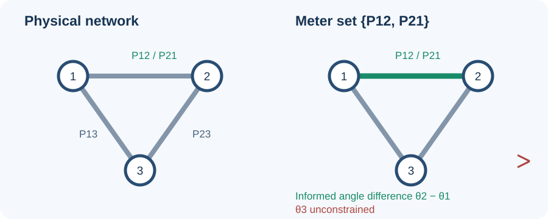

# Observability analysis and restoration

### Lesson 06 · From measurement information to observable islands

Graduate course · EESC–USP · Based on Prof. João Bosco A. London Junior's 2024 lectures

---

## Learning outcomes

By the end of this lesson, you should be able to:

1. Distinguish physical connectivity, algebraic observability, and numerical conditioning.
2. Construct a $P\theta$ measurement Jacobian and interpret its null space.
3. Verify observability using rank, a spanning-tree argument, and a factorization diagnostic.
4. Identify observable regions and design a measurement that restores missing information.
5. Explain why observability alone does not ensure gross-error detectability or resilience.

**Roadmap:** concept → equations → numerical example → topology → islands → restoration → laboratory.

Note: Begin with the operator's question: can the estimator infer the complete state from the measurements actually available now?

---

## Where does observability fit in the EMS?

Topology processing → **observability analysis and restoration** → state estimation → bad-data processing → network applications.

- Topology processing identifies the bus/branch electrical model.
- Observability examines whether available readings constrain every required state direction.
- Restoration can add physical, virtual, or pseudo-measurement information.
- Only then should a conventional full-network WLS estimator be treated as well-posed.

**Question:** can an electrically connected network be unobservable? **Yes.**

Reading: [1] §5.1; [2] Chapter 7.

---

## Three different kinds of information

**Physical:** a branch exists and carries power, regardless of whether it is metered.

**Structural:** a particular measurement equation connects certain state variables.

**Numerical/statistical:** the Jacobian coefficients and covariance determine how strongly the measurements constrain the state.

A disconnected physical grid implies separate electrical islands. A connected grid **does not** imply one observable island.

Note: Ask students to suggest a network with a connected tie line but no information about its angle difference.

---

## The state and the measurements

For an $n_b$-bus AC network with one reference angle:

$$x=[\theta_2,\ldots,\theta_{n_b},V_1,\ldots,V_{n_b}]^T,\qquad n_x=2n_b-1.$$

The model is

$$z=h(x)+e,\qquad E[e]=0,\qquad E[ee^T]=R\succ0.$$

The rows of the Jacobian $H(x)=\partial h/\partial x$ correspond to available measurements: flows, injections, voltage magnitudes, phasors, or justified constraints.

**Do not conflate:** the number of available rows $m$ and the number of independent rows $\operatorname{rank}(H)$.

---

## Local algebraic observability

At a specified operating point $x_0$, let $H_0=H(x_0)$, with the angle reference already fixed.

$$\boxed{\operatorname{rank}(H_0)=n_x}$$

is the standard local Jacobian-rank test for regular state identifiability. Equivalently, if $R\succ0$:

$$G=H_0^TR^{-1}H_0\succ0.$$

This is a **local** criterion; it does not assert unique global recovery for every nonlinear model, nor guarantee convergence from an arbitrary initial point.

Reading: [1] §5.1.1; [2] §§7.1.11 and 13.6.4.

---

## The null space makes missing information visible

In the linearized measurement model, $\Delta z=H\Delta x$.

If $v\ne0$ and $Hv=0$, then

$$H(\Delta x+\alpha v)=H\Delta x,\qquad\forall\alpha\in\mathbb R.$$

Measurements cannot distinguish changes along $v$. Therefore:

$$\dim\ker H=n_x-\operatorname{rank}(H).$$

**Classroom prompt:** if the nullity equals two after fixing the global reference, how many independent state directions remain uninformed? **Two.**

---

## The angle-reference caveat

In the reference-free $P\theta$ formulation, each power-flow row satisfies

$$P_{ij}=b_{ij}(\theta_i-\theta_j),\qquad H\mathbf 1=0.$$

There is always a global angle freedom. A fully observable connected $P\theta$ model has

$$\operatorname{rank}(H)=n_b-1,$$

**before** fixing the reference. After setting, for example, $\theta_1=0$, the reduced matrix must have rank $n_b-1$.

An extra null vector, beyond the uniform-angle shift, represents missing information.

---

## WLS cannot invent independent measurements

The objective is

$$J(x)=[z-h(x)]^TR^{-1}[z-h(x)].$$

The linear normal equations use $G=H^TR^{-1}H$. For any $R\succ0$:

$$\ker G=\ker H.$$

Replacing a variance by a much smaller positive value increases its weight but **does not change rank**. Repeating the same independent equation with the same state sensitivity also does not inform a missing direction.

Note: A highly precise but dependent meter does not restore observability.

---

## Counting sensors is not enough

A necessary condition is $m\ge n_x$. It is not sufficient.

For a two-state example:

$$H_A=\begin{bmatrix}1&0\\-1&0\end{bmatrix},\qquad \operatorname{rank}(H_A)=1.$$

The readings disagree or agree about the **same** state component. The second component is invisible.

Compare:

$$H_B=\begin{bmatrix}1&0\\0&1\end{bmatrix},\qquad\operatorname{rank}(H_B)=2.$$

---

## Worked system: three-bus DC network

Let $\theta_1=0$, $x=[\theta_2,\theta_3]^T$, and branch susceptances $b_{12}=25$, $b_{13}=20$, $b_{23}=12.5$ p.u. on the adopted model basis.

The numerical values follow the course's Assignment 2 measurement Jacobian. A physical line can be unmetered even if the estimator knows its parameters.

Note: The picture's colored labels distinguish physical branches from selectable meter channels.

---

## Build the Jacobian one row at a time

With $P_{ij}=b_{ij}(\theta_i-\theta_j)$:

| Measurement | Equation | Row of $H$ for $[\theta_2,\theta_3]$ |
|---|---|---|
| $P_{12}$ | $-25\theta_2$ | $[-25,0]$ |
| $P_{21}$ | $25\theta_2$ | $[25,0]$ |
| $P_{13}$ | $-20\theta_3$ | $[0,-20]$ |
| $P_{23}$ | $12.5(\theta_2-\theta_3)$ | $[12.5,-12.5]$ |
| $P_1$ | $-25\theta_2-20\theta_3$ | $[-25,-20]$ |
| $P_2$ | $37.5\theta_2-12.5\theta_3$ | $[37.5,-12.5]$ |

A bus injection is a balance of incident branch flows; it cannot be counted as multiple independent readings.

---

## Case A: exactly enough independent information

Enable only $\{P_{12},P_{13}\}$:

$$H_A=\begin{bmatrix}-25&0\\0&-20\end{bmatrix},\quad\operatorname{rank}(H_A)=2.$$

The system is observable. However, both readings are **critical**: removing either one drops the rank to one.

**Predict before calculating:** is an observable set necessarily robust against one lost measurement? **No.**

---

## Case B: two meters, one informed direction

Enable only $\{P_{12},P_{21}\}$:

$$H_B=\begin{bmatrix}-25&0\\25&0\end{bmatrix},\quad\operatorname{rank}(H_B)=1.$$

$$\ker H_B=\operatorname{span}\{[0,1]^T\}.$$

Both meters observe $\theta_2$; neither observes $\theta_3$. Reverse-direction flows are redundant in this idealized lossless DC model, **not** in all more detailed models.

---

## Geometry of the estimation problem

- Rank 2: independent measurement surfaces intersect at a unique point in the two-dimensional state space.
- Rank 1: the measurements identify a line of possible states.
- Rank 0: both state coordinates are unconstrained.

For a full-rank weighted Jacobian $A=R^{-1/2}H$, the smallest singular value measures the weakest constrained direction, given consistent units.

**Important:** a very small nonzero singular value means poor conditioning, not exact unobservability.

---

## Topological observability: the central idea

A topological test in the $P\theta$ framework looks for a **spanning tree** covering all buses, with a **distinct measurement assigned to every tree branch** under the applicable flow/injection assignment rules.

- A measured branch flow can be assigned to its own branch.
- An injection measurement can be assigned to an incident branch, subject to the method's consistency rules.
- One physical measurement cannot be assigned twice as two independent equations.

This is the idea of a full-rank measurement spanning tree, not merely any spanning tree of the physical grid.

Reading: [1] §5.1.2; [2] §7.1.2.

---

## A topological exercise

Consider the three-bus triangular network.

**Plan A:** $P_{12}$ and $P_{13}$ → edges $(1,2)$ and $(1,3)$ form a full-rank tree.

**Plan B:** $P_{12}$ and $P_{21}$ → both refer to edge $(1,2)$, leaving no assigned edge that connects bus 3.

**Plan C:** $P_{12}$ and $P_{23}$ → edges $(1,2)$ and $(2,3)$ form a full-rank tree.

Check these three claims by computing rank. This simple flow-only example illustrates the principle; injection-based assignments require the proper algorithm.

---

## Physical islands versus observable islands

A physical island is a disconnected electrical component. An observable island is a region for which the relevant state relationships can be determined using the available measurement set.

In a connected network with $\{P_{12},P_{21}\}$, the angle difference between buses 1 and 2 is known, while bus 3 retains an independent angle freedom.

For more complex injection configurations, identifying maximal observable islands requires appropriate treatment of measurements spanning candidate boundaries.

Reading: [2] §§7.1.1, 7.1.8–7.1.9; [1] §5.1.3.

---

## Why cross-boundary injections complicate islands

At bus $i$:

$$P_i=\sum_{j\in\mathcal N_i}b_{ij}(\theta_i-\theta_j).$$

This is **one row** of $H$ even though it contains several branches. When islands are studied separately, an injection involving unknown cross-boundary flows may not be usable as a purely internal island equation.

A measurement can be informative in the full coupled system yet be **irrelevant or discardable for a particular island decomposition**. One must not delete it casually without updating the method.

---

## Numerical methods: an independent perspective

In the reference-free $P\theta$ model:

$$G_\theta=H_\theta^TWH_\theta.$$

For an observable connected network, $G_\theta$ has exactly one zero eigenvalue from the arbitrary global angle origin. Additional independent null directions indicate missing information.

Classical numerical methods exploit triangular factorizations and zero pivots, often with iterative handling of measurements that couple potential islands.

Reading: [1] §5.1.3; [2] §§7.1.3–7.1.5.

---

## Why zero pivots require care

For a symmetric positive-semidefinite gain matrix, exact rank deficiency produces zero pivots under a suitable elimination strategy. In floating-point arithmetic:

- Ordering, scaling, and pivot tolerances matter.
- Forming $H^TWH$ squares the condition number of the whitened Jacobian (in 2-norm, for full rank).
- A rank-revealing QR or SVD is a good reference diagnostic for small teaching cases.

The laboratory uses rank tests on $H$, not a claim to implement the historical Monticelli–Wu or Bretas algorithms.

---

## Restoration: add information, not just a meter

For an unobservable $H$, a candidate row $h_p^T$ restores one missing direction only when

$$\operatorname{rank}\begin{bmatrix}H\\h_p^T\end{bmatrix}>\operatorname{rank}(H).$$

Starting from $\{P_{12},P_{21}\}$:

- Adding $P_{13}$ restores rank 2.
- Adding $P_{23}$ also restores rank 2.
- Adding a third duplicate of $P_{12}$ leaves rank 1.

**Ask:** which meter would you install if cost, accuracy, and failure grouping differed?

---

## Pseudomeasurement versus measured channel

A forecasted injection, modeled load, or historical relationship may supply a **pseudomeasurement**. It can be useful for restoration if its Jacobian row adds independent information.

However, a pseudo-reading typically has greater uncertainty and may have correlated or systematic modeling error. Treat its uncertainty consistently; do not present a restored result as equally reliable to one supported by independent telemetry.

If a **virtual measurement** represents an exact physical constraint (e.g., a known zero injection), it belongs to a different constraint-handling category from a noisy load forecast.

Reading: [1] §5.1; [2] §7.3.

---

## What happens to the WLS covariance?

For the full-rank local linear model:

$$\operatorname{Cov}(\hat x)=(H^TR^{-1}H)^{-1}.$$

Adding an independent, appropriately modeled reading cannot increase the covariance in the positive-semidefinite order. But:

- A barely informative pseudo-reading may leave large variances.
- Two readings sharing an unmodeled systematic error may offer less information than the diagonal-$R$ model implies.
- Better precision does not prove resilience to individual sensor failures.

---

## Redundancy: three distinct levels of assurance

**Observability:** can the state be determined at all?

**Detection:** can the measurement set reveal an inconsistency?

**Identification:** can it reliably distinguish which channel is inconsistent, under an explicit error model?

The 2024 course's redundancy lecture uses one, two, and three measurements of the same underlying quantity to illustrate this progression. It is an intuition, not a universal guarantee for arbitrary error patterns.

Reading: [1] §§5.2 and 6.3; Lesson 07's redundancy discussion.

---

## A critical measurement is a structural vulnerability

A measurement $i$ is **critical** when the original set is observable but removing $i$ makes it unobservable:

$$\operatorname{rank}(H)=n_x,\qquad\operatorname{rank}(H_{-i})<n_x.$$

In a standard unconstrained linear WLS fit, a critical measurement has a zero residual because its information direction cannot be cross-checked by the other channels.

Consequence: a sufficiently large error in that measurement need not be detectable by conventional residual consistency tests.

Reading: [1] §§5.2 and 6.3; [2] Chapter 8.

---

## Local redundancy and p-critical sets (preview)

A **p-critical set** is an inclusion-minimal set of $p$ measurements whose simultaneous removal makes an initially observable system unobservable.

- $p=1$: critical measurement.
- $p=2$: critical pair.
- $p=3$: critical triple.

In the supplied course material, a channel's redundancy level is the size of its smallest containing p-critical set minus one. This captures loss vulnerability **around the channel** rather than the global ratio $m/n_x$.

Lesson 08 develops $H_\Delta$, critical sets, and measurement-system reinforcement.

---

## A meter failure may mean several lost rows

A remote terminal unit (RTU/UTR), common communication link, or shared supply can fail and simultaneously remove several measurements.

For a device group $\mathcal C$, test

$$\operatorname{rank}(H_{\setminus\mathcal C})=n_x.$$

A plan without individually critical measurements may still contain a **critical RTU**. This is a separate reliability constraint from rank in normal operation.

Reading: [1] §5.4; 2024 lecture on measurement-system strengthening.

---

## Practical workflow for operations

1. Receive topology and the current measurement availability flags.
2. Form the correct model and reduced/anchored Jacobian.
3. Check rank and numerical conditioning with documented tolerances.
4. If deficient, determine observable islands with a valid island algorithm.
5. Propose physically justified new measurements/pseudomeasurements.
6. Recheck rank, precision, criticality, and relevant device contingencies.

Always report whether the conclusion is **structural**, **local numerical**, or **statistical**.

---

## Interactive laboratory · Three-bus observability

<a href="../assets/labs/observabilidade.html" target="_blank" rel="noopener">Open the laboratory in a separate tab</a>

Explore how measurement placement affects the observability of a power system.

In this experiment, you will:

1. Select different measurement configurations.
2. Evaluate the rank of the measurement Jacobian.
3. Identify unobservable state variables.
4. Restore observability by adding measurements.
5. Investigate measurement redundancy and criticality.

**The interactive laboratory is available on the next slide.**

Suggested sequences:

1. Activate $P_{12}$ and $P_{13}$. Record rank and critical channels.
2. Replace $P_{13}$ with $P_{21}$. Explain the null-space direction.
3. Restore with $P_{23}$ and compare with a low-precision pseudo-reading.
4. Enable all six channels, then remove one and two at a time.
5. Trigger a grouped RTU outage; explain why device resilience differs from one-channel resilience.

Note: The dedicated laboratory runs as a standalone HTML page. The original Assignment 2 laboratory is also appended as this lesson's final slide by the course builder.

---

## Discussion and assessment

**Conceptual:** Is an observable network always well-conditioned? Why not?

**Algebraic:** Given $H=[[-25,0],[25,0],[0,-20]]$, find $\operatorname{rank}(H)$ and list the critical measurements.

**Planning:** If bus 3 is not observable, why might $P_{23}$ be more valuable than a second $P_{12}$ sensor?

**Reliability:** What additional information is required to claim resilience to an RTU failure?

---

## Answers and instructor notes

- Observable does not imply well-conditioned: rank is qualitative; singular values quantify weak information directions.
- The three-row example has rank 2; $P_{13}$ is critical, while neither $P_{12}$ nor $P_{21}$ is critical individually.
- $P_{23}$ has a nonzero coefficient on $\theta_3$ and adds an independent direction; a duplicate $P_{12}$ does not.
- Map each channel to its RTU and test removal of all channels belonging to that RTU.

In a nonlinear AC study, repeat the test at the operating point and explicitly state how the reference and exact constraints are handled.

---

## Connecting the three observability lessons

**Lesson 06:** definitions, algebra, topological intuition, islands, and restoration.

**Lesson 07:** numerical/topological methods, factorization paths, irrelevant injections, and local redundancy.

**Lesson 08:** critical measurements, critical sets, $H_\Delta$, redundancy levels, and measurement-system reinforcement.

The laboratory's direct rank and loss-set enumeration are **small-system teaching benchmarks**, not substitutes for full production-scale sparse algorithms.

---

## References

**[1]** N. G. Bretas, J. B. A. London Jr., and B. E. B. de Carvalho, *Estimação de Estado em Sistemas Elétricos de Potência*, 2019 manuscript, supplied version dated 18 Sep. 2020, §§5.1–5.2, 5.4 and 6.3 (PDF pp. 100–~128).

**[2]** A. Monticelli, *State Estimation in Electric Power Systems: A Generalized Approach*, Kluwer, 1999, Chapter 7 (printed pp. 161–198; PDF pagination differs), particularly §§7.1 and 7.3.

Original teaching inputs: 2024 Lesson 6 (observability and restoration), Lesson 7 (methods and redundancy), Lesson 8 (critical sets, redundancy levels, and measurement planning). Equations and explanatory language here are newly written for the course. This lesson's laboratory is a direct-rank teaching implementation, not a reproduction of the named historical methods.
